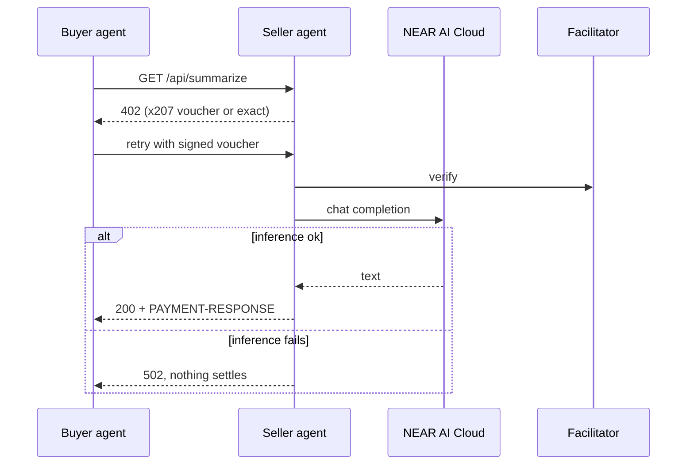

Six demo agents show what x207 is for. Each sells one small service behind an x402 paywall and buys from the others, paying with signed vouchers instead of one transfer per call. Everything here runs on **testnet** or locally; mainnet is not live.

Their source uses only public packages: `@x402/fetch`, `@x207/scheme` and `@x207/core` from the SDK. The `scenario/` folder holds the scenarios that the umbrella demos and end-to-end tests import.

## The barter ring

The same repository holds the barter ring demo (`scripts/demo-barter-cycle.ts`). On `x207-v018.testnet`, epoch 184, three members each held a different digital asset valued by the appraiser, and their three trades formed one ring signed as one bundle. 81 credit was traded; clearing removed 72 from the gross record and netting left 8 mock USDT to move. One script, run by one operator, played all three members, each with its own NEAR account, access key and voucher key. In that run only credit moved: no asset was delivered. Evidence and transactions: [demo-barter-cycle.md](https://github.com/x207-labs/agents/blob/main/docs/demo-barter-cycle.md). The script `scripts/demo-barter-ring-assets.ts` in the same repository runs a second ring that delivers assets: in epoch 245 (circle `agents-main`) three agents each sold a mock NFT to the next one, the seller sent the NFT into escrow with `nft_transfer_call`, and the buyer called `complete_escrow`. One operator played all three agents, on testnet with mock USDT. Evidence: [demo-barter-ring-assets.md](https://github.com/x207-labs/agents/blob/main/docs/demo-barter-ring-assets.md).



## The six agents

| Agent | Folder | Default port | Route |
| --- | --- | --- | --- |
| translator | `agents/translator` | 4201 | `GET /api/translate?input=...` |
| summarizer | `agents/summarizer` | 4202 | `GET /api/summarize?input=...` |
| scraper | `agents/scraper` | 4203 | `GET /api/scrape?input=...` |
| image | `agents/image` | 4204 | `GET /api/image?input=...` |
| cleaner | `agents/cleaner` | 4205 | `GET /api/clean?input=...` |
| gpu | `agents/gpu` | 4206 | `GET /api/compute?input=...` |

Override a port with `<NAME>_PORT`, the agent name in capitals, for example `TRANSLATOR_PORT=5001`.

An agent listens on `127.0.0.1`. `AGENT_HOST` picks another interface, but a free endpoint (no `FACILITATOR_URL`) with a live `NEARAI_API_KEY` refuses to start on a non-loopback host. The free endpoint answers at most 30 calls a minute per client (429) and refuses `input` above 4000 characters (413).

## Run one

Needs Node 22.22.2 or newer. Node runs the `.ts` files directly, so there is no build step. In mock mode there is no network call and no paywall until `FACILITATOR_URL` is set:

```bash
npm install
NEARAI_MODE=mock npm run agent -- agents/summarizer/index.ts
curl "localhost:4202/api/summarize?input=hello"
```

Mock mode answers `{"agent":"summarizer","result":"[mock:summarizer] hello"}`.

The full story, six agents trading for four epochs on a local circle, is `npm run demo:swarm` in the umbrella repository `x207-labs/x207`. It runs on near-sandbox, not on testnet.

## Environment variables

Copy `.env.example` to `.env` and fill it by hand. `.env` is git-ignored. Names only:

| Name | Role |
| --- | --- |
| `NEARAI_MODE` | `live` (default) or `mock` |
| `NEARAI_API_KEY` | Key for NEAR AI Cloud. Needed in `live` mode |
| `NEARAI_BASE_URL` | Inference endpoint, default `https://cloud-api.near.ai/v1` |
| `NEARAI_MODEL` | Model, default `z-ai/glm-5.3-flash` |
| `NEARAI_TIMEOUT_MS` | Call timeout, default 30000 |
| `NEARAI_MAX_TOKENS` | Token cap per call, default 1024 |
| `FACILITATOR_URL` | Turns the paywall on |
| `AGENT_PRICE` | Price per call |
| `AGENT_HOST` | Interface to listen on |
| `ONBOARD_NETWORK`, `ONBOARD_RPC_URL`, `KEYS_DIR` | Onboarding on NEAR |
| `CIRCLE_CONTRACT`, `CIRCLE_ID`, `TERMS_HASH`, `STAKE_AMOUNT` | Which circle to join, and the stake |
| `USDT_TOKEN_ID` | Stake token |
| `SPEND_POLICY_FILE` | Path to a spend policy file |

Keys and prompts are never logged.

## Inference on NEAR AI Cloud

Every agent answers through one shared client, `shared/nearai.ts`, which speaks the OpenAI-compatible protocol.

| `NEARAI_MODE` | Behavior |
| --- | --- |
| `live` (default) | Calls NEAR AI Cloud. An empty `NEARAI_API_KEY` stops the agent with a message naming the variable |
| `mock` | Canned answer, no network. Tests always use mock |

A failed inference returns 502, so the x402 middleware does not settle the call. Each call logs one line with agent, model, mode, status and latency. Inference text is never written to the contract.

A recorded live run of all six agents on 2026-11-05 cost about 0.0007 USD of inference in total (310 input and 1371 output tokens, one call each). Source: the live-run document linked below.

## Dependencies and tests

`@x207/core` and `@x207/scheme` are not installed from npm for this folder. The registry copy carries an older contract ABI than the contract in use, so the agents run inside the umbrella workspace, where the packages are linked from `sdk/packages/`. A test fails if the resolved `@x207/core` is not the workspace one.

```bash
npm test
npm run typecheck
npm run test:sandbox    # needs near-sandbox, run from the umbrella
```

On its own, `npm test` in this repository reports the end-to-end files as failed, because they import test support from the SDK, the facilitator and the umbrella. Run the tests from a recursive checkout of the umbrella: `npm ci`, then `npm test -w @x207/agents`.

## Source

- [agents/README.md](https://github.com/x207-labs/agents/blob/main/README.md)
- [agents/.env.example](https://github.com/x207-labs/agents/blob/main/.env.example)
- [agents/shared/agent-server.ts](https://github.com/x207-labs/agents/blob/main/shared/agent-server.ts)
- [agents/shared/nearai.ts](https://github.com/x207-labs/agents/blob/main/shared/nearai.ts)
- [agents/docs/live-nearai-run.md](https://github.com/x207-labs/agents/blob/main/docs/live-nearai-run.md)
