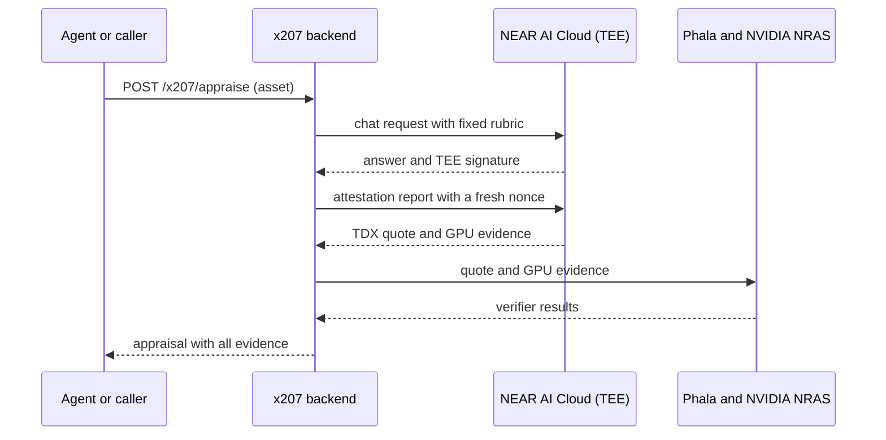

Barter assets such as API quota, compute, licences and data have no market price. The appraiser gives the two parties a starting number. It is advice only.

> Signature checked locally; quote checked via third-party verifiers (Phala, NVIDIA NRAS).

## What it is, and what it is not

`POST /x207/appraise` sends an asset description to a model on [NEAR AI Cloud](https://cloud.near.ai), which runs private inference inside a trusted execution environment (TEE). The model answers with a value in credit, a range, a confidence and a rationale, using a fixed rubric. x207 stores the exact request and response bytes and the evidence that comes with them.

- The value is advice. The two parties of a barter still agree on the price.
- The circle contract does not read appraisals. Nothing on chain depends on one.
- A model can be wrong, or be steered by the text of the asset. The rubric asks it to treat that text as data and to flag doubts; nothing guarantees it.
- The demo agent calls the appraiser before it prices a listing, keeps an appraised price within 50% of the owner's own price, and names the appraisal in the listing `detail` as `appraisal=apr_...`. The marketplace listing then carries an `appraisal` summary, which the dashboard shows as a badge with a proof button.



## Endpoints

Base URL of the active circle: `%ACTIVE_API%`. The recorded appraisals below are stored on `https://v018.x207.boxd.sh`.

| Method | Path | Purpose |
| --- | --- | --- |
| POST | `/x207/appraise` | Appraise one asset. `201` with the appraisal, `200` with `cached: true` when the same request was appraised before. |
| GET | `/x207/appraisals/{id}` | The asset, the answer, the exact request and response bytes, the TEE signature and an attestation summary. |
| GET | `/x207/appraisals/{id}/attestation` | The raw Intel TDX quote and NVIDIA GPU evidence of appraisal time, byte-exact, about 110 KB. |

```bash
curl -s -X POST %ACTIVE_API%/x207/appraise \
  -H 'content-type: application/json' \
  -d '{"asset_type":"api_quota","asset_class":"B","quantity":100000,"scope":"100000 geocoding calls, read-only","provider":"Mapbox","duration_days":30,"market_price_credits":"75"}'
```

Limits: 20 appraisals per client address per day and 200 per day in total, counted in SQLite so a restart does not reset them. The body limit is 4096 bytes. Without a key on the server the route answers `503 appraiser_disabled`; when the NEAR AI credit is used up it answers `503 appraiser_credits_exhausted`.

## Model

The model is fixed on the server to an allowlist of NEAR AI Cloud models that run inside a TEE. The default is `Qwen/Qwen3.6-35B-A3B-FP8`. A proxied `anthropic/`, `google/` or `openai/` model is refused at start.

## Chain of evidence

Each appraisal links these steps. Each one says who checked it.

| Step | What it shows | Checked by |
| --- | --- | --- |
| Request and response hashes | SHA-256 of the stored bytes equals the stored hashes. | x207 and the verify script, locally |
| Signature | NEAR AI Cloud signs `model:sha256(request):sha256(response)` with a secp256k1 key (EIP-191). Recomputing both hashes and recovering the signer gives `signing_address`. | x207 and the verify script, locally |
| Key binding | For each appraisal x207 picks a fresh random nonce and fetches the attestation report with it. The TDX `report_data` must carry `signing_address`, 12 zero bytes and the nonce. | x207 and the verify script, locally |
| TDX quote | The quote is sent to the Phala verifier. x207 does not run Intel DCAP itself. | Phala (third party) |
| GPU evidence | The evidence is sent to NVIDIA NRAS. x207 reads the result claims but does not check the signature of the returned token. | NVIDIA NRAS (third party) |
| Rubric | `rubric.hash` is the SHA-256 of the rubric version, system prompt and flag list. The script recomputes it from the system prompt in the request bytes. | The verify script, locally |

## Check it again without x207

`backend/scripts/verify-appraisal.ts` needs no x207 code and no key. It recomputes every hash and the signer, re-checks the stored attestation evidence, fetches a fresh attestation with its own nonce, and prints PASS, FAIL or SKIP for each check.

```bash
node scripts/verify-appraisal.ts https://v018.x207.boxd.sh/x207/appraisals/apr_6edab5eac2b78e65d41ea3b2 --quote-check
```

It needs Node 22.6 or newer. A recorded run on 2026-11-12 (`Qwen/Qwen3.6-35B-A3B-FP8`, 496 prompt and 133 completion tokens, about USD 0.00023, 4.6 s, with `--quote-check`) gave 21 PASS, one SKIP (signature refetch without a key) and no FAIL. Changing one byte of the stored answer makes the response-hash check FAIL.

## Live example

Appraisal `apr_6edab5eac2b78e65d41ea3b2`, made on 2026-11-12: 10 bundles of 10,000 geocoding calls from a provider with a market price of 75 credit. The model valued it at 60 credit (range 45 to 70, confidence 0.7), flagging `market_price_used` and `transferability_risk` because the key stays with the seller and the buyer calls through a proxy.

Read it: `https://v018.x207.boxd.sh/x207/appraisals/apr_6edab5eac2b78e65d41ea3b2`

## What this does not cover

- The attestation is fetched right after the chat, not inside it. It shows that the key that signed the answer belonged to a TEE at that time. It does not prove which code ran for that one call beyond `compose_hash`.
- If the TEE instance that signed a chat restarts with a new key, a fresh attestation no longer matches. The stored evidence from appraisal time is then the only record.
- The quote and GPU checks depend on two third parties, Phala and NVIDIA NRAS.
- It does not close the credit headroom gap across facilitators. Credit limits and headroom are not enforced across facilitators by an appraisal; see [Security and limits](/docs/security).
- It is not a price oracle and not part of clearing or settlement.

## Source

- [backend/README.md](https://github.com/x207-labs/backend/blob/main/README.md), section Appraiser
- [backend/src/appraiser/](https://github.com/x207-labs/backend/tree/main/src/appraiser)
- [backend/scripts/verify-appraisal.ts](https://github.com/x207-labs/backend/blob/main/scripts/verify-appraisal.ts)
