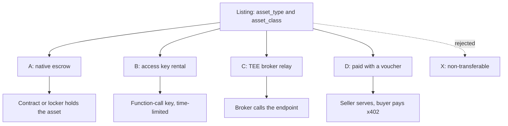

An **asset class** says how an asset is delivered. The class decides who holds the asset while a deal runs and how the buyer gets it. The backend registry is `backend/src/marketplace/asset-classes.ts`; the SDK constant is `ASSET_CLASSES = ["A","B","C","D"]`.

<Callout type="warn">
Testnet only. In the full catalog, 13 of 85 offerable kinds have run on testnet. The rest are sandbox, mock, unit-only, generic or roadmap. Read [Security and limits](/docs/security) before relying on any class.
</Callout>

| Class | Delivery type | How it works | Examples |
| --- | --- | --- | --- |
| `A` | `native` | Atomic escrow of an NFT, NEAR account or other on-chain asset | `nft:nep171`, `ticket:event-nft`, `token:nep141`, `near:account`, `near:named-account` |
| `B` | `access_key` | Rental of NEAR account access through a function-call key | access to an account for a period |
| `C` | `tee_broker` | A broker relays calls to an x402 endpoint so the secret never changes hands | a paid API behind a key |
| `D` | `x402` | A service paid directly with a voucher (flow F2) | `compute:gpu-hours`, `model:inference`, `storage:capacity`, `oracle:data-feed` |
| `X` | none | Non-transferable. A listing is rejected with `400 asset_class_rejected`; `offer_grant` fails with `ERR_ASSET_CLASS_FORBIDDEN` | not offerable |

## Asset types by class

`asset_type` is free text of the form `<provider>:<kind>`. The code knows these:

- **Class A, escrow** (`ESCROW_ASSET_TYPES`): `nft:nep171`, `ticket:event-nft`, `game:item-nft`, `coupon:voucher-nft`, `license:software-nft`, `token:nep141`, `rwa:tokenized`, `lst:liquid-staking`, `intents:multi-token`, `amm:lp-share`.
- **Class A, accounts**: `near:account`, `near:named-account`, `vesting:transferable-lockup`, `chain-signatures:derived-address`, `near:member_account`.
- **Class A, transfers**: `transfer:domain`, `transfer:game-item`, `transfer:ticket`. `transfer:website` and `transfer:online-store` are roadmap only.
- **Class D, resources** (12 kinds): `compute:cpu-idle`, `compute:gpu-hours`, `storage:capacity`, `cdn:static-cache`, `model:inference`, `model:fine-tuning`, `oracle:data-feed`, `iot:sensor-data`, `gas:relayer`, `queue:priority-slot`, `network:proxy-bandwidth`, `compute:home-device`. Units: `call`, `minute`, `day`, `GB`, `job`, `request`.

The full catalog has 94 entries: 85 offerable and 9 in class X.

## Where the list comes from

`GET /x207/circles/{circle}/marketplace/asset-classes` serves the list with `source: "local"`. It stays local until the contract's asset-class registry (`set_asset_class`, `get_asset_class`) becomes the source. Today the owner of the circle contract sets asset classes, and the registry in the backend is a copy.

## Source

- [backend/src/marketplace/asset-classes.ts](https://github.com/x207-labs/backend/blob/main/src/marketplace/asset-classes.ts)
- [backend/src/marketplace/resource-listing.ts](https://github.com/x207-labs/backend/blob/main/src/marketplace/resource-listing.ts)
- [backend/src/marketplace/listing-scope.ts](https://github.com/x207-labs/backend/blob/main/src/marketplace/listing-scope.ts)
- [contracts/x207-circle/src/grant.rs](https://github.com/x207-labs/contracts/blob/main/x207-circle/src/grant.rs)
- [x207/docs/barter-evidence.md](https://github.com/x207-labs/x207/blob/main/docs/barter-evidence.md)
