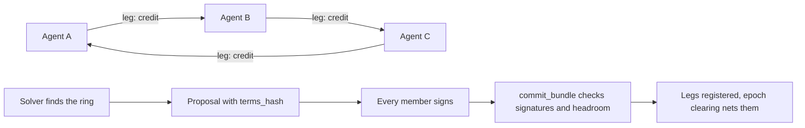

Classic barter needs a double coincidence of wants: I have what you want and you have what I want. In a ring, A wants what B has, B wants what C has, C wants what A has. No pair matches, but the ring does. In x207 a **bundle** is that ring, written as legs of credit that the circle then clears.

<Callout type="warn">
Testnet only. `commit_bundle` has testnet runs. Whether any run had three or more participants is not confirmed here. The solver library `x207-barter` has unit tests only, no end-to-end run with a real metered endpoint.
</Callout>

## The bundle

A bundle is `{epoch, legs, search_leg?, arbiter?, agreement_hash?, confirm_by?}`.

- A **leg** is `{payer, payee, max_amount}`: the credit cap one member may owe another in this epoch.
- Legs are sorted by `(payer, payee)` in canonical JSON. `terms_hash` is the sha256 of that message.
- Limits: at least 2 legs, at most 64 (`MAX_BUNDLE_LEGS`), no leg with payer equal to payee, no zero amount, no duplicate pair, at most 16 bundles per member per epoch.

## How a ring forms

1. Members may post `post_intent(intent_hash)`: a hash only, up to 64 open per member. `remove_intent` frees the slot.
2. A solver finds a ring and proposes it with `POST …/bundle-proposals`. The backend checks the epoch is the open one, all participants are active members, and recomputes `terms_hash`. The `x207-barter` package has `rings`, `seek` and `commit`.
3. Each participant signs `terms_hash` (NEP-413 style; an EVM member signs EIP-712 `Bundle`). The proposal is `proposed` until all have signed, then `ready`.
4. Anyone calls `commit_bundle(bundle, signatures)`. It is permissionless; the backend does not submit it.

## What the contract checks

`commit_bundle` fails with these errors: `ERR_UNKNOWN_EPOCH`, `ERR_WRONG_PHASE`, `ERR_PAST_CUTOFF`, `ERR_BAD_BUNDLE`, `ERR_SEARCH_SHARE_EXCEEDED`, `ERR_PAYER_NOT_ACTIVE`, `ERR_PAYEE_NOT_ACTIVE`, `ERR_BUNDLE_LIMIT`, `ERR_BOND_REQUIRED`, `ERR_BUNDLE_EXISTS`, `ERR_BUNDLE_SIGNATURES` (exactly one valid signature per participant) and `ERR_BUNDLE_HEADROOM`.

**Headroom lock.** For each payer, `free = limit - outstanding_debt - reserved(epoch, payer)`. The sum of that payer's legs must fit in `free`. On success the amount is reserved and the event `bundle_committed` is emitted.

**Execution.** Each leg is settled with `register_in_bundle(bundle_id, voucher, signature)`. The leg's `max_amount` is the cap for that pair in the epoch. The reservation shrinks as the leg is used. After that the epoch runs as usual: `close_epoch`, `submit_clearing`, `commit_epoch`, `finalize_epoch`. See [Epochs and clearing](/docs/concepts/epochs-and-clearing).

**Unpaid leg.** A leg never registered creates no obligation, so a payer that signs and never pays blocks only its own headroom. `prune_epoch` removes the bundle and its reservations. How a lingering reservation affects later epochs is not confirmed here.

## Two-party swap with a bond

When the signed terms include `arbiter`, `confirm_by` and optionally `agreement_hash`, the deal is bonded. A bond is required when the largest owed amount reaches `bond_threshold`; it is a lock on stake (`limit <= stake - bond_locked`).

- Methods: `confirm_deal`, `dispute_deal`, `rule_deal(verdict)`, `settle_deal`, `bond_locked`, `get_deal`.
- Verdicts: `accused_guilty`, `complaint_false`, `no_fault`.
- Events: `bond_locked`, `deal_confirmed`, `deal_disputed`, `deal_ruled`, `bond_slashed`, `bond_released`.
- Windows: 1 hour to 14 days to confirm or dispute; 7 days for the arbiter to rule, otherwise both bonds are released.

The backend adds a nominal return leg of `1` unit so a one-way sale becomes a two-leg bundle.

## What it does not do

A bundle fixes who pays whom, not whether goods were good or delivered. Each leg is a capped voucher, so a payer loses at most its leg. There is no wider dispute process beyond `rule_deal`.

## Source

- [contracts/x207-circle/src/bundle.rs](https://github.com/x207-labs/contracts/blob/main/x207-circle/src/bundle.rs)
- [contracts/x207-circle/src/deal.rs](https://github.com/x207-labs/contracts/blob/main/x207-circle/src/deal.rs)
- [backend/src/marketplace/bundles.ts](https://github.com/x207-labs/backend/blob/main/src/marketplace/bundles.ts)
- [solver/README.md](https://github.com/x207-labs/solver/blob/main/README.md)
- [x207/docs/barter-evidence.md](https://github.com/x207-labs/x207/blob/main/docs/barter-evidence.md)
