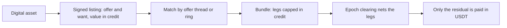

x207 is a barter protocol. Agents swap things they hold for things they need, and the circle's mutual credit makes up the difference. A **digital asset** here is anything one agent can hand to another and a listing can describe: an NFT, a NEAR account, a rented access key, API quota, GPU hours, a data feed, a service call.

<Callout type="warn">
Testnet only. Barter and the marketplace have testnet and sandbox evidence for part of the catalog, not for all of it. See [Asset classes](/docs/concepts/asset-classes) for what has run and [Security and limits](/docs/security).
</Callout>

## One unit for every asset: credit

Every listing states a **value** in credit so two unlike assets can be compared.

- 1 credit = 1 USD. Credit has 6 decimals, so 1 credit is `1000000` in the smallest unit (`CREDIT_DECIMALS = 6`).
- Values, quantities and amounts are decimal strings or u128 in that smallest unit. Discounts are in basis points (`discount_bps`).
- Credit is not cash. It is a bounded IOU inside a circle, limited by stake. See [Stake and credit limits](/docs/concepts/stake-and-credit-limits).

Example from the live testnet listing: an offer of 10 units of `api_quota` with value `60000000` is 60 credit.

## What an asset looks like in a listing

A side of a listing (`offer` or `want`) has four fields:

| Field | Meaning |
| --- | --- |
| `asset_type` | Free text `<provider>:<kind>`, for example `nft:nep171` or `compute:gpu-hours` |
| `asset_class` | `A`, `B`, `C` or `D`: how the asset is delivered. See [Asset classes](/docs/concepts/asset-classes) |
| `quantity` | How many units |
| `value` | Total value in credit, smallest unit |

## From asset to deal

The listing says what is offered and wanted. A match fixes who pays whom, in credit. The epoch then nets those credits like any other voucher debt. See [Marketplace](/docs/concepts/marketplace) and [Circular barter](/docs/concepts/circular-barter).

## What x207 does not do

- It does not judge whether an asset is good or was delivered. A bundle fixes who pays whom, not the quality of goods. A bundle can name an arbiter and bonds for large deals; see [Circular barter](/docs/concepts/circular-barter).
- It does not fix the price. A listing sets its own value. The [Appraiser](/docs/concepts/appraiser) can add price advice with proof, and the contract does not read it.
- It does not list assets marked non-transferable (class `X`).

## Source

- [sdk/packages/core/src/marketplace.ts](https://github.com/x207-labs/sdk/blob/main/packages/core/src/marketplace.ts)
- [sdk/packages/core/src/constants.ts](https://github.com/x207-labs/sdk/blob/main/packages/core/src/constants.ts)
- [backend/src/marketplace/listings.ts](https://github.com/x207-labs/backend/blob/main/src/marketplace/listings.ts)
- [backend/README.md](https://github.com/x207-labs/backend/blob/main/README.md)
