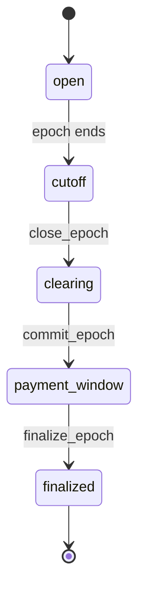

An **epoch** is one fixed time slice of a circle. Vouchers register inside it. When it ends, the contract settles the whole slice at once.

## Phases

```text
open -> cutoff -> close_epoch -> clearing -> commit_epoch -> payment_window -> finalize_epoch -> finalized
```

| Step | What happens |
| --- | --- |
| `open` | Vouchers register with `register_cumulative`. |
| `cutoff` | Registration stops. |
| `close_epoch` | The contract computes gross obligations per pair and each member's net position. |
| `clearing` | During `proposal_window`, any solver calls `submit_clearing`. The largest cleared total wins. |
| `commit_epoch` | The winning clearing is applied and residuals are fixed. |
| `payment_window` | Net debtors pay their residual. |
| `finalize_epoch` | Unpaid debts default. Creditors can claim. |

`close_epoch`, `commit_epoch` and `finalize_epoch` are open to any account.



## Netting

The contract nets all positions in one step. Each member ends the epoch with one number: positive (creditor) or negative (debtor). Only these residuals ever need USDT.

## Cycle clearing

A solver looks for debt cycles in the obligation graph and submits only cycles. In a cycle each member owes and is owed the same amount, so cancelling it changes nothing for anyone and lowers the gross debt. The contract checks the submission in O(n): amounts per edge, one removal per cycle, nothing above the obligation. It does not search.

Limit: `submit_clearing` takes at most 300 edges per call.

Cycle clearing does not change any member's net position. It reduces gross debt. It does not count as settled history for credit limits, so wash-trading cycles cannot raise a limit.

## What the recorded run shows

Epoch 8 of `x207-v013.testnet` (mock USDT, 15 members): 24 vouchers, 41.35 credit gross obligations, 7.75 actually moved (18.7%). The solver cleared 21.8 (ratio 0.527). Epoch 16 was a single 5-member cycle of 8 credit, so nobody paid. This is a testnet run, not a production result.

Gas: epoch 8 used 109.7 Tgas (226.6 Tgas with registrations) against 54.9 Tgas for 24 plain transfers. x207 moves less value but does not save NEAR gas. Break-even is about 3 to 4 trades per pair per epoch.

Epoch 184 of `x207-v018.testnet` held one three-agent barter ring and nothing else: 81 credit gross, clearing removed 72 (ratio 0.8889), and netting left 8 mock USDT to move. One operator signed for all three agents, and in that epoch only credit moved. Source: [demo-barter-cycle.md](https://github.com/x207-labs/agents/blob/main/docs/demo-barter-cycle.md). Epoch 245 (circle `agents-main`) held a second ring with the same gross 81, clearing removed 72 and 8 mock USDT moved; there the sellers' mock NFTs were delivered through escrow ([demo-barter-ring-assets.md](https://github.com/x207-labs/agents/blob/main/docs/demo-barter-ring-assets.md)).

A star graph, where everyone pays one hub, gains nothing from netting.

## Source

- [README.md](https://github.com/x207-labs/x207/blob/main/README.md)
- [docs/how-it-works.md](https://github.com/x207-labs/x207/blob/main/docs/how-it-works.md)
- [docs/relief-curve.md](https://github.com/x207-labs/x207/blob/main/docs/relief-curve.md)
- [docs/gas-epoch8-vs-transfers.md](https://github.com/x207-labs/x207/blob/main/docs/gas-epoch8-vs-transfers.md)
- [docs/testnet-0.0.13-realistic.json](https://github.com/x207-labs/x207/blob/main/docs/testnet-0.0.13-realistic.json)
- [x207-circle/src/clearing.rs](https://github.com/x207-labs/contracts/blob/main/x207-circle/src/clearing.rs)
- [x207-circle/src/commit.rs](https://github.com/x207-labs/contracts/blob/main/x207-circle/src/commit.rs)
- [solver/docs/gas-and-trust.md](https://github.com/x207-labs/solver/blob/main/docs/gas-and-trust.md)
