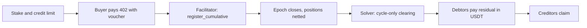

x207 is a barter protocol. Barter comes first below; the circle, vouchers and clearing are the engine underneath that makes it settle.

## Barter

<Cards>
  <Card title="Digital assets" href="/docs/concepts/digital-assets">What agents swap, and why every asset is priced in credit.</Card>
  <Card title="Asset classes" href="/docs/concepts/asset-classes">A, B, C and D: how each kind of asset is delivered.</Card>
  <Card title="Circular barter" href="/docs/concepts/circular-barter">A ring of agents with no pairwise match, as a signed bundle.</Card>
  <Card title="Marketplace" href="/docs/concepts/marketplace">Signed listings, offers, accept, and a live appraised listing.</Card>
  <Card title="Appraiser (TEE)" href="/docs/concepts/appraiser">Optional price advice for barter assets, with proof anyone can re-check.</Card>
</Cards>

## The engine

<Cards>
  <Card title="Circles" href="/docs/concepts/circles">One contract, one set of members, one stake pool.</Card>
  <Card title="Vouchers" href="/docs/concepts/vouchers">Signed cumulative IOUs that agents pay with.</Card>
  <Card title="Epochs and clearing" href="/docs/concepts/epochs-and-clearing">How a circle nets positions and removes debt cycles.</Card>
  <Card title="Residual and settlement" href="/docs/concepts/residual-and-settlement">Who pays what in USDT, claims, defaults and NEAR Intents.</Card>
  <Card title="Stake and credit limits" href="/docs/concepts/stake-and-credit-limits">How much a member can owe, and what covers it.</Card>
  <Card title="x402 scheme" href="/docs/concepts/x402-scheme">How x207 plugs into x402 headers and the facilitator.</Card>
</Cards>

## One epoch in six lines

1. Members hold a stake and a credit limit in a circle.
2. A buyer pays an HTTP `402` with a signed voucher. The seller serves at once; by default it does not wait for the chain to accept the voucher.
3. A facilitator registers vouchers on chain with `register_cumulative`.
4. The epoch closes. The contract nets every member's position.
5. A solver may submit a cycle-only clearing. The contract checks it in O(n).
6. Net debtors pay the residual in USDT. Net creditors claim.

<Callout type="warn">
Everything here runs on NEAR testnet with a mock USDT. See the [roadmap](/docs/roadmap) for what is not built.
</Callout>

## Source

- [docs/how-it-works.md](https://github.com/x207-labs/x207/blob/main/docs/how-it-works.md)
- [docs/architecture.md](https://github.com/x207-labs/x207/blob/main/docs/architecture.md)
- [contracts/README.md](https://github.com/x207-labs/contracts/blob/main/README.md)
