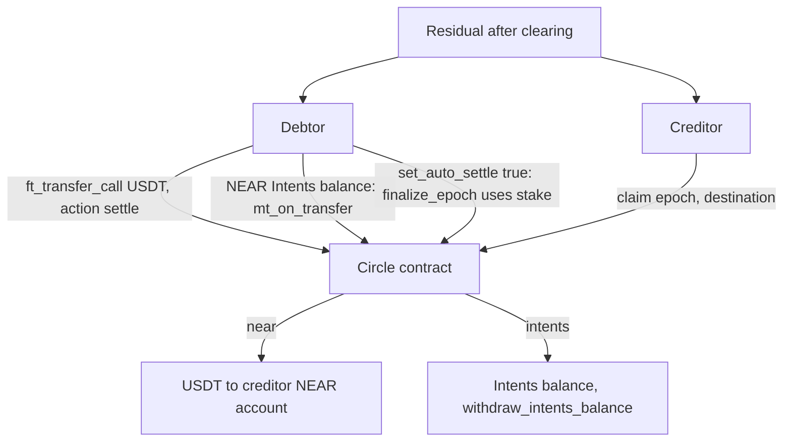
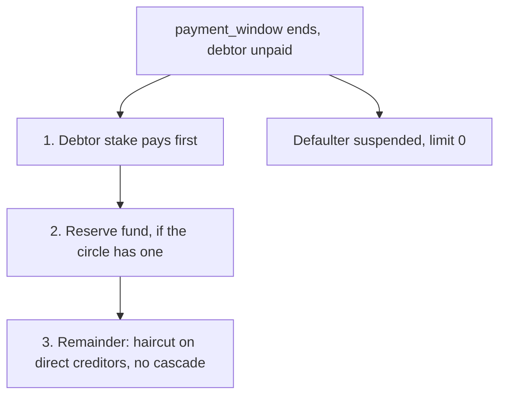

After clearing, each member has a **residual**: what it still owes the circle (debtor) or is owed (creditor). Only residuals are paid, in USDT.

## Paying

A debtor pays during `payment_window` with an `ft_transfer_call` of USDT to the circle, msg action `settle`. A debtor can also pay from a NEAR Intents balance: `mt_on_transfer` accepts the transfer.

A member may opt in to `set_auto_settle(true)`. Then `finalize_epoch` settles that member's residual from its own stake (contract 0.0.15 and later).

## Claiming

A creditor calls `claim(epoch, destination)`. The destination is one of:

- `near`: USDT goes to the creditor's NEAR account.
- `intents`: the amount credits an Intents balance, from where it can be withdrawn to another chain. On testnet the Intents side is a mock, and a cross-chain withdrawal has run only as a dry 1Click quote (see below). `withdraw_intents_balance` is permissionless.

`claim` attaches a deposit, so it needs a full-access NEAR key, not the voucher key. The same goes for `join` and `settle`.

## Default

A debtor that has not paid when the window ends is in default.

1. The debtor's stake pays first.
2. A reserve fund comes next, if the circle has one.
3. Any remainder is a haircut on direct creditors, with no cascade.

Under `limit <= stake` the stake covers the whole debt, so steps 2 and 3 do not trigger. The defaulter is `suspended` with limit 0.

In epoch 8 of `x207-v013.testnet`, 5 debtors paid, 1 defaulted (0.55 covered from its stake), and 3 of 8 creditors had claimed when the run was recorded.

## NEAR Intents

x207 uses NEAR Intents only for the residual and the creditor withdrawal. It does not clear inside Intents.

What has run:

- The residual of 3 debtors was paid in one `execute_intents` call against the real `intents.near` wasm, in a local `near-sandbox`.
- A 1Click dry quote ran on 2026-11-04: 5 credit to USDC on Base returned 4.989148 USDC. No funds moved.

What has not run: nothing against `intents.near` on testnet or mainnet. `intents.testnet` has no code.

## Source

- [docs/how-it-works.md](https://github.com/x207-labs/x207/blob/main/docs/how-it-works.md)
- [docs/what-has-run.md](https://github.com/x207-labs/x207/blob/main/docs/what-has-run.md)
- [docs/security-and-limits.md](https://github.com/x207-labs/x207/blob/main/docs/security-and-limits.md)
- [x207-circle/src/settlement.rs](https://github.com/x207-labs/contracts/blob/main/x207-circle/src/settlement.rs)
- [x207-circle/src/intents_withdraw.rs](https://github.com/x207-labs/contracts/blob/main/x207-circle/src/intents_withdraw.rs)
- [x207-circle/src/stake.rs](https://github.com/x207-labs/contracts/blob/main/x207-circle/src/stake.rs)
