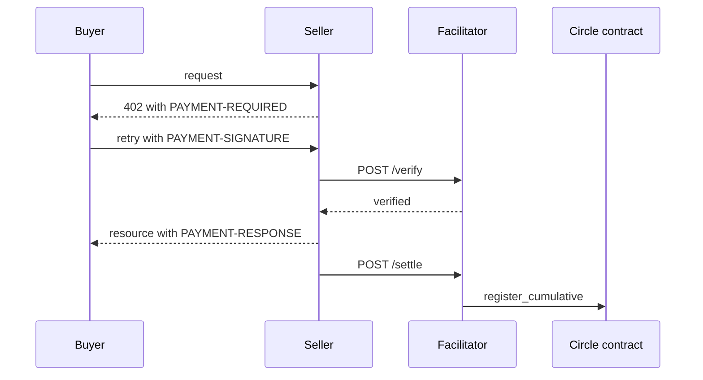

x207 plugs into x402 as a binding of the `batch-settlement` scheme. The network is `x207:<circleId>`, a CAIP-2 identifier (regex `^[-a-z0-9]{3,8}:[-_a-zA-Z0-9]{1,32}$`). The binding is capital-backed and pooled across a circle.

<Callout type="warn">
This is a proposal. It was opened upstream as x402-foundation/x402#4131. Nobody has accepted it yet.
</Callout>

## Headers

x402 version 2 headers are used unchanged: `PAYMENT-REQUIRED`, `PAYMENT-SIGNATURE`, `PAYMENT-RESPONSE`.

## Payment requirement entry

| Field | Value |
| --- | --- |
| `scheme` | `batch-settlement` |
| `network` | `x207:<circleId>` |
| `asset` | `USD` |
| `extra.circleContract` | the circle contract, for example `x207-v018.testnet` |
| `extra.unit` | `credit` |
| `extra.decimals` | 6 |
| `extra.epoch` | current epoch |
| `maxTimeoutSeconds` | 60 |

A seller can list a companion `exact` entry on `near:mainnet` for buyers outside the circle.

## Facilitator

| Endpoint | Purpose |
| --- | --- |
| `POST /verify` | 19 ordered checks on the voucher and the payer. |
| `POST /settle` | Registers the voucher on chain (`register_cumulative`). |
| `GET /supported` | Lists the scheme and networks. |
| `GET /x207/pair-state` | Current state of a payer and payee pair. |

Reason codes include `insufficient_credit`, `epoch_closing`, `seq_not_increasing`, `cumulative_decreased`, `amount_mismatch`, `member_not_active`, `circle_mismatch`, `account_frozen` and `registration_retry_pending`.

The `transaction` field in the settle response is a commitment id `<payer>:<payee>:<epoch>:<seq>`, not a NEAR transaction hash. A registration is `pending`, `registered` or `retrying`.

## 207 report

`GET /x207/circles/{circle}/epochs/{n}` returns one status per member, mapped to HTTP codes: 200 paid, zero or claimed; 402 due; 202 claimable; 409 defaulted.

## Source

- [sdk/spec/scheme_batch_settlement_x207.md](https://github.com/x207-labs/sdk/blob/main/spec/scheme_batch_settlement_x207.md)
- [sdk/spec/voucher-format.md](https://github.com/x207-labs/sdk/blob/main/spec/voucher-format.md)
- [sdk/docs/seller-quickstart.md](https://github.com/x207-labs/sdk/blob/main/docs/seller-quickstart.md)
- [backend/docs/reference.md](https://github.com/x207-labs/backend/blob/main/docs/reference.md)
- [README.md](https://github.com/x207-labs/x207/blob/main/README.md)
