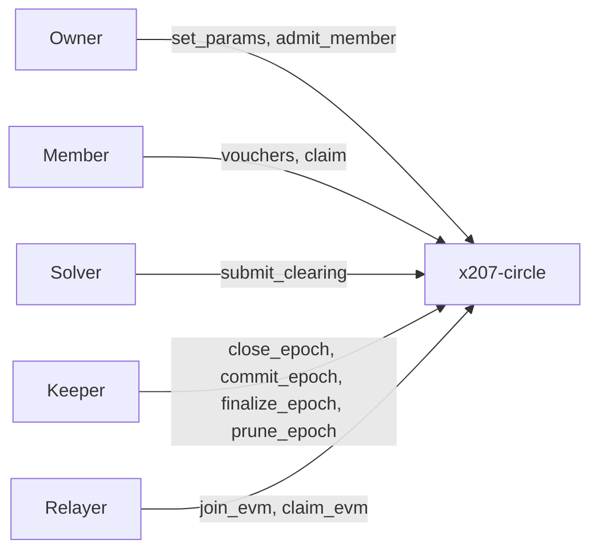
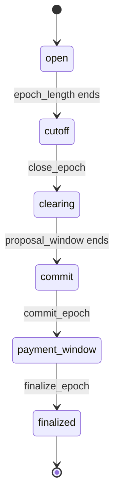
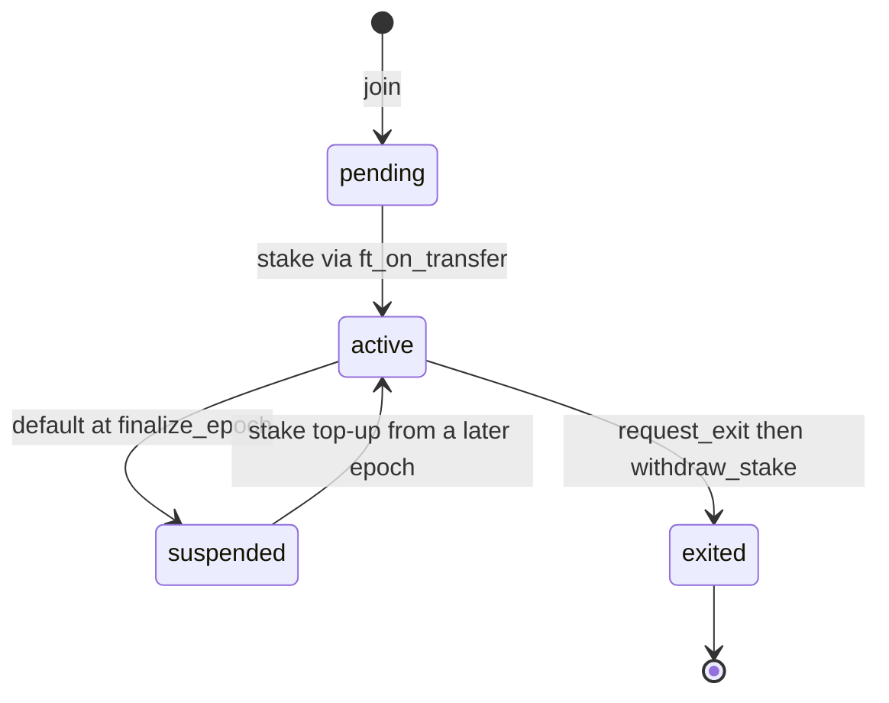

`x207-circle` is a Rust contract for NEAR. It is the one place where a circle is true. It holds the members and their stakes, records signed vouchers per pair, accepts a clearing proposal from any solver after checking it on chain, applies the best one, covers a default from the debtor's stake, and lets creditors claim USDT.

Everything else in x207 (the SDK, the backend indexer and read API, the solver, the dashboard) reads or calls this contract.

> Testnet only. No mainnet deploy has been made. See [Deployments](/docs/deployments) and [Security and limits](/docs/security).

## Interface version

The interface in `contracts/abi.json` is **0.0.18** (`INTERFACE_VERSION` in `x207-circle/src/lib.rs`): 106 public functions (calls and views) and 52 events. Every event log carries this version in its envelope. The ABI file is the frozen reference; names on these pages are copied from it and from the Rust source.

## Contract set

| Path | Contents |
| --- | --- |
| `x207-circle/src/` | The circle contract. One module per area: `member.rs`, `stake.rs`, `voucher.rs`, `clearing.rs`, `verifier.rs`, `commit.rs`, `settlement.rs`, `bundle.rs`, `deal.rs`, `grant.rs`, `escrow.rs`, `account_escrow.rs`, `freeze.rs`, `params.rs`, `risk.rs`, `evm.rs`, `auto_settle.rs`, `intents_withdraw.rs`, `pending.rs`, `prune.rs`, `upgrade.rs`, `events.rs`, and others |
| `locker/` | `x207-locker`, a small contract put on a NEAR account that is for sale. It releases a full-access key to the buyer only when the circle says so (interface 0.0.18) |
| `dao/` | Scripts that print Sputnik DAO proposal commands (for `set_params` and the like) |
| `tests/` | `near-sandbox` integration tests and unit tests |
| `probes/` | Mock token, NFT, multi-token, Intents and gas-probe contracts used by tests and rehearsals |
| `abi.json` | Frozen contract interface |
| `scripts/` | `repro-build.sh`, `verify-release.sh`, `fetch-intents-wasm.sh` |

## Roles

The contract has no special roles beyond these. Most steps are open to anyone.

| Role | Who | What they can do |
| --- | --- | --- |
| Owner | `owner_id` set at `new`; on `x207-v013.testnet` a Sputnik DAO, on `x207-v018.testnet` a team account | `set_params`, `admit_member`, freeze and upgrade with timelocks, asset classes, official contract lists |
| Member | An account that called `join` and staked | Registers vouchers, takes part in clearing, claims |
| Solver | Any account | `submit_clearing`; the best proposal of an epoch is kept |
| Keeper | Any account | `close_epoch`, `commit_epoch`, `finalize_epoch`, `prune_epoch` |
| Relayer | Any account | Relays signed actions of EVM members (`join_evm`, `claim_evm`, and others) |



## Epoch phases

`get_epoch` reports one of: `open`, `cutoff`, `clearing`, `commit`, `payment_window`, `finalized`.

```text
open --(epoch_length ends)--> cutoff
cutoff --close_epoch--> clearing        any solver may submit_clearing
clearing --(proposal_window ends)--> commit
commit --commit_epoch--> payment_window  net debtors pay (settle)
payment_window --finalize_epoch--> finalized   defaults covered, creditors claim
```



## Member life

`get_member` reports one of `pending`, `active`, `suspended`, `exited`.

- `join` makes a `pending` member (with a storage deposit of 0.35 NEAR, `JOIN_STORAGE_DEPOSIT`).
- A stake via `ft_on_transfer` with `{"action":"stake"}` (and DAO admission when `admission` is `dao`) makes it `active`.
- A default at `finalize_epoch` makes it `suspended`. A later stake top-up reactivates it from a later epoch (`member_reactivated`).
- `request_exit`, then `withdraw_stake` once the exit epoch is `finalized` and no debt remains, makes it `exited`.



## Credit limit

The limit is computed by `compute_limit` in `risk.rs`:

```text
limit = min(limit_cap, stake * base_limit_ratio / 10000 + settled_history * limit_growth / 10000, stake)
```

The limit never exceeds the stake. It grows only from residual paid in cash (`settled_history`); a cycle that clears completely adds nothing. `limit_decay` lowers the limit of idle members at `finalize_epoch`.

## Fixed limits in code

| Constant | Value | Where |
| --- | --- | --- |
| `MAX_MEMBERS` | 64 | `member.rs` |
| `MAX_EDGES_PER_TX` | 300 edges per proposal | `types.rs` |
| `JOIN_STORAGE_DEPOSIT` | 0.35 NEAR | `member.rs` |
| `MAX_OPEN_INTENTS_PER_MEMBER` | 64 | `bundle.rs` |
| `MAX_BUNDLES_PER_MEMBER_PER_EPOCH` | 16 | `bundle.rs` |
| `MAX_BUNDLE_LEGS` | 64 | `bundle.rs` |
| `MAX_OPEN_DEALS_PER_MEMBER` | 8 | `deal.rs` |
| `MAX_ACTIVE_GRANTS_PER_MEMBER` | 16 | `grant.rs` |
| `MAX_PRUNE_ITEMS_PER_CALL` | 200 | `prune.rs` |
| `FREEZE_TIMELOCK_NS`, `UPGRADE_TIMELOCK_NS` | 24 hours each | `freeze.rs`, `upgrade.rs` |
| `RULING_WINDOW_NS` | 7 days | `deal.rs` |
| `PENDING_GC_AFTER_NS` | 7 days (owner can change, 1 hour to 30 days) | `pending.rs` |

## Default parameters

`new` takes `params` or `null`; `null` gives these defaults (`params.rs`). `set_params` stores new values for the **next** epoch; `close_epoch` applies them.

| Field | Default | Allowed range |
| --- | --- | --- |
| `epoch_length` (s) | 3600 | 300 to 604800 |
| `payment_window` (s) | 1800 | 900 to 604800 |
| `proposal_window` (s) | 600 | 60 to 86400 |
| `base_limit_ratio` (bps) | 8000 | at most 10000 |
| `limit_growth` (bps) | 1000 | at most 10000 |
| `limit_cap` | 1,000,000,000 (1,000 credit) | 1,000,000 to 100,000,000,000 |
| `limit_decay` (bps) | 0 | at most 5000 |
| `fees.clearing_fee_bps` | 0 | at most 100 |
| `fees.solver_fee_bps` | 0 | at most 100 |
| `admission` | `open` | `open` or `dao` |
| `max_search_share_bps` | 500 | at most 10000 |
| `bond_threshold` | 100,000,000 (100 credit) | 10,000,000 to 1,000,000,000,000 |
| `bond_bps` | 2000 | 500 to 5000 |
| `prune_delay_epochs` | 2 | 1 to 30 |
| `relayer_fee` | 0 | at most `RELAYER_FEE_MAX` (1,000,000 units) |

One credit is 1,000,000 units (`CREDIT_DECIMALS` is 6).

## Build and test

Needs Rust 1.99.1 with the `wasm32-unknown-unknown` target (pinned in `rust-toolchain.toml`) and `cargo-near` 0.22.0.

```bash
cargo near build non-reproducible-wasm
cargo test
```

Sandbox tests need the wasm from the build step. A sandbox test that walks a whole epoch takes about one minute because it fast-forwards block time.

Check a release against a deployed account (needs Docker for the reproducible build):

```bash
scripts/repro-build.sh <git-ref> <outdir>               # prints the sha256 of x207_circle.wasm
scripts/verify-release.sh v0.0.13 [account] [rpc-url]
```

The wasm is built in a pinned container, so two builds of one commit give the same bytes. What the check proves and what it does not: `contracts/docs/verify-release.md`.

## Cost

On testnet, a full epoch of 210 edges among 15 members burnt 0.1075 NEAR (about 0.0005 NEAR per edge); `commit_epoch` of 210 edges burnt 69.4 Tgas. Every number with its transaction hash is in `contracts/docs/gas-and-cost.md`.

## Pages in this section

- [Methods](/docs/contracts/methods): every call method
- [Views](/docs/contracts/views): every view method
- [Events and errors](/docs/contracts/events-and-errors): event fields and error codes

## Source

- https://github.com/x207-labs/contracts/blob/main/README.md
- https://github.com/x207-labs/contracts/blob/main/abi.json
- https://github.com/x207-labs/contracts/blob/main/x207-circle/src/lib.rs
- https://github.com/x207-labs/contracts/blob/main/x207-circle/src/params.rs
- https://github.com/x207-labs/contracts/blob/main/x207-circle/src/risk.rs
- https://github.com/x207-labs/contracts/blob/main/docs/verify-release.md
- https://github.com/x207-labs/contracts/blob/main/docs/gas-and-cost.md
