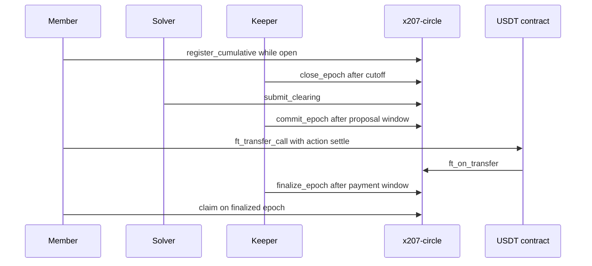

All amounts are strings holding integers (`U128` in JSON) in token units; one credit is 1,000,000 units. Epochs and ids are integers. Names and parameters are copied from `contracts/abi.json` (interface 0.0.18). Error codes are listed in [Events and errors](/docs/contracts/events-and-errors). Read-only methods are in [Views](/docs/contracts/views).

"Permissionless" means any account may call. "Owner" means `owner_id` (on `x207-v013.testnet` a Sputnik DAO acting through proposals; on the active `x207-v018.testnet` the team account `x207-v18-own.testnet`); the contract panics with `ERR_NOT_OWNER` otherwise.

## Setup

| Method | Parameters | Caller | Behaviour |
| --- | --- | --- | --- |
| `new` | `owner_id`, `circle_id`, `usdt_token_id`, `intents_id`, `params` (or `null`) | Init, once | Opens epoch 1 now with `cutoff_at = now + epoch_length`. `params` `null` takes the defaults. The token of a circle is fixed here; there is no setter. |
| `migrate` | none | The contract itself (`#[private]`) | Runs on new code right after an upgrade; keeps the stored state. |

## Membership and stake

| Method | Parameters | Caller | Behaviour |
| --- | --- | --- | --- |
| `join` | `circle_id`, `pubkey_voucher`, `terms_hash` | Any account; attach at least the storage deposit (0.35 NEAR) | Registers the caller as a `pending` member. Checks deposit, `circle_id`, an ed25519 key, `terms_hash` (64 lowercase hex), not already a member, the 64-member cap. Deposit above 0.35 NEAR is returned. |
| `admit_member` | `account_id` | Owner | When `admission` is `dao`: admits a `pending` member. The status stays `pending` until stake arrives. |
| `ft_on_transfer` | `sender_id`, `amount`, `msg` | The USDT contract (via `ft_transfer_call`) | Entry for token transfers. `msg` is JSON with an `action`: `{"action":"stake"}` (optional `member_id`) adds stake; `{"action":"settle","epoch":N}` (optional `member_id`) pays a residual; `{"action":"escrow","grant_id":N}` fills a class A escrow with a NEP-141 token. Returns the amount to refund (0 when all was used). |
| `mt_on_transfer` | `sender_id`, `previous_owner_ids`, `token_ids`, `amounts`, `msg` | The Intents contract, or a NEP-245 contract for escrow | `settle` for a payment that comes from Intents as the single token `nep141:<usdt_token_id>`; the debtor is `previous_owner_ids[0]`. Also the `escrow` action for multi-token escrows. |
| `request_exit` | none | A member; attach 1 yoctoNEAR | Asks to leave at the end of the current epoch. Later-epoch vouchers and more stake are refused with `ERR_EXITING`. |
| `withdraw_stake` | none | A member; attach 1 yoctoNEAR | Pays the stake back once the exit epoch is `finalized` and no debt remains. A stake of 0 exits at once. A failed transfer restores stake and limit (`stake_withdraw_failed`). |
| `remove_pending` | `account_id` | Owner at any time; anyone for a never-admitted member that has been `pending` for the garbage-collection delay | Removes a `pending` member with no stake, debt or withdrawal in flight; frees the slot; returns an EVM sponsor's deposit. |
| `set_pending_gc_delay` | `seconds` | Owner | Delay before anyone may remove a never-admitted `pending` row. Default 7 days; allowed 1 hour to 30 days. |

## Vouchers

A voucher has the fields `circle`, `payer`, `payee`, `resource`, `unit`, `epoch`, `seq`, `cumulativeAmount`. The signature is ed25519 by the payer's `pubkey_voucher` (or EIP-712 for an EVM member). Registration has no caller restriction: the signature is the gate, so a facilitator or the payee can submit it.

| Method | Parameters | Caller | Behaviour |
| --- | --- | --- | --- |
| `register_cumulative` | `voucher`, `signature` | Permissionless | Default registration. Records the new cumulative total for the pair in the epoch; checks circle, unit, ASCII resource, payer not equal payee, epoch, cutoff, both parties `active`, monotonic `seq`, non-decreasing cumulative, signature and the payer's headroom. Returns the pair obligation. |
| `register_voucher` | `voucher`, `signature` | Permissionless | Demo mode: one voucher per request, `seq` must be `last_seq + 1`. Same checks and state as `register_cumulative`. |
| `register_in_bundle` | `bundle_id`, `voucher`, `signature` | Permissionless | Registers a voucher that settles a leg of a committed bundle. The leg caps what the pair may owe in the bundle epoch. |

## Epoch cycle

| Method | Parameters | Caller | Behaviour |
| --- | --- | --- | --- |
| `close_epoch` | `epoch` | Permissionless, after the cutoff (`ERR_BEFORE_CUTOFF`) | Locks the epoch (phase `clearing`, proposal window opens) and opens the next one with pending params applied. |
| `submit_clearing` | `epoch`, `edges` (each `debtor`, `creditor`, `cleared`) | Permissionless; the caller is recorded as the solver | Verifies the proposal in one pass over the edges (at most 300): each `cleared` is within its obligation and each member's cleared inflow equals its outflow. Stores it only if it beats the stored one. Returns `cleared_total`. Does not change obligations until `commit_epoch`. |
| `commit_epoch` | `epoch` | Permissionless, after the proposal window | Applies the best proposal, writes the net position of every member (debtor `due`, creditor `claimable`), and pays the fee split. The log carries `edge_count` and `edges_hash`, not the edges. |
| `finalize_epoch` | `epoch` | Permissionless, after the payment window | Every position still `due` defaults: covered from the debtor's stake, then the reserve, into the epoch pool. The member becomes `suspended`. Recomputes limits, applies `limit_decay`, finalizes the epoch. Members with auto-settle on are paid from stake first (`auto_settled`). |
| `prune_epoch` | `epoch`, `max_items` (up to 200) | Permissionless | Removes entries of a `finalized` epoch and returns how many it removed. Refused with `ERR_PRUNE_TOO_EARLY` until the running epoch is at least `prune_delay_epochs` after `epoch`. |
| `set_params` | `params` | Owner | Validates and stores the params as pending for the next epoch. A second call in the same epoch overwrites the first. |

## Settlement

| Method | Parameters | Caller | Behaviour |
| --- | --- | --- | --- |
| `claim` | `epoch`, `destination` (`near` or `intents`) | A creditor of a `finalized` epoch; attach 1 yoctoNEAR | Pays the caller's residual in USDT, to its NEAR account or to its Intents balance. A failed transfer makes the position claimable again (`residual_claim_failed`). |
| `claim_solver_fee` | none | A solver with a fee balance; attach 1 yoctoNEAR | Pays out the solver fee earned at `commit_epoch`. |
| `withdraw_intents_balance` | none | Permissionless | Moves the booked Intents balance (from residuals paid through Intents) to the circle's NEP-141 account. |
| `set_auto_settle` | `enabled` | A member; attach 1 yoctoNEAR | Opts in or out of settling a due residual from its own stake at `finalize_epoch`. Counts for epochs committed after the opt-in. |

## Barter bundles and deals

| Method | Parameters | Caller | Behaviour |
| --- | --- | --- | --- |
| `post_intent` | `intent_hash` | An `active` member | Posts the hash of a barter intent (up to 64 open per member). |
| `remove_intent` | `intent_hash` | The intent's owner; anyone if the owner has `exited` | Removes the intent and frees the slot. |
| `commit_bundle` | `bundle` (`epoch`, `legs`, optional `arbiter`, `confirm_by`, `agreement_hash`), `signatures` | Permissionless | Commits a multi-party bundle only if every participant signed the same `terms_hash`; legs well formed, participants active, headroom available for every payer. Nothing is written before the last check passes. Returns `bundle_id`. With an `arbiter`, it opens a deal with bonds. |
| `confirm_deal` | `bundle_id` | A party of the deal | Says the other party delivered; releases the other party's bond. |
| `dispute_deal` | `bundle_id`, `evidence_hash` | A party, before `confirm_by` | Says the other party did not deliver. One dispute per deal. |
| `rule_deal` | `bundle_id`, `verdict` (`accused_guilty`, `complaint_false`, `no_fault`) | The arbiter only, within 7 days of the dispute | Rules on a disputed deal; a ruling moves only what the stake still holds. |
| `settle_deal` | `bundle_id` | Permissionless, once the deal is due | Releases bonds when `confirm_by` has passed (open) or when the arbiter stayed silent past the ruling window (disputed). |

## Access grants and asset escrow

| Method | Parameters | Caller | Behaviour |
| --- | --- | --- | --- |
| `set_asset_class` | `asset_type`, `entry` (`asset_type`, `class`, `accepted_proofs`, `delivery_methods`, `terms_hash`) | Owner | Registers or replaces an asset class (A, B, C, D or X). Class X is refused for offers. |
| `set_asset_contracts` | `asset_type`, `contracts` | Owner | Official token contracts for a class A asset type (up to 16). Empty clears the list. |
| `offer_grant` | `input` (`asset_type`, `delivery_method`, `limits`, `unit`, `unit_price`, optional `operator`, `proof_kind`, `proof_hash`) | An `active` member | Offers access to an asset. Returns `grant_id`. |
| `accept_grant` | `grant_id`, `delivery_pubkey` (or `null`) | An `active` member other than the grantor | Accepts an `offered` grant before it expires. |
| `revoke_grant` | `grant_id`, `reason` (`grantor`, `grantee`, `operator`, `expired`, `defaulted`) | Grantor, grantee or operator at any time; anyone after expiry or when the grantee is suspended | Final. Refused while an escrow holds the asset. |
| `nft_on_transfer` | `sender_id`, `previous_owner_id`, `token_id`, `msg` | An NFT contract (NEP-171) | Receives the NFT of a class A grant into escrow. `msg` is JSON with the `grant_id`. |
| `complete_escrow` | `grant_id`, `voucher`, `signature` | The buyer (payer of the voucher) | Buyer pays the grantor by voucher and receives the asset; the grant becomes `active`. A failed asset transfer takes the registration back. |
| `cancel_escrow` | `grant_id` | The grantor, after the grant expires | Takes the asset back when nobody bought it. |
| `account_on_lock` | `grant_id` | The locker on the sold NEAR account | Records an account escrow as `held` (interface 0.0.18). |
| `complete_account_escrow` | `grant_id`, `voucher`, `signature`, `delivery_pubkey` | The buyer | Like `complete_escrow` for an account: the locker adds the buyer's full-access key. |
| `cancel_expired_account_escrow` | `grant_id` | Permissionless, after expiry | Returns the account to the seller via the key recorded at lock time. |
| `set_locker_code_hashes` | `hashes` | Owner | Official locker code hashes (up to 8) for clients to compare. |
| `set_max_escrow_ttl` | `ttl_ns` | Owner | Longest time an account grant may still run when the locker registers. Default 72 hours; allowed 1 hour to 30 days. |

## Freeze and upgrade (owner, with timelocks)

| Method | Parameters | Caller | Behaviour |
| --- | --- | --- | --- |
| `propose_freeze` | `account_id`, `reason_hash` | Owner | Starts a 24-hour timelock; the member sees `freeze_proposed` and can settle or leave first. |
| `apply_freeze` | `account_id` | Permissionless, after the timelock | Freezes the member. |
| `cancel_freeze` | `account_id` | Owner, while pending | Cancels the proposal. |
| `unfreeze_member` | `account_id` | Owner | Lifts a freeze at once. |
| `propose_upgrade` | `code_hash` | Owner | Starts a 24-hour timelock; a new proposal replaces a pending one. |
| `apply_upgrade` | raw wasm as input | Owner | Checks the timelock and that the sha256 of the input equals the proposed `code_hash`, then deploys and calls `migrate`. |

## EVM members (relayed, signature-gated)

An EVM member is an account id of the form `0x` plus 40 lowercase hex characters. Anyone may relay these calls; the member's EIP-712 signature (with `nonce`, `deadline`, `max_fee`) is the gate. The first action after a join carries nonce 0.

| Method | Parameters | Behaviour |
| --- | --- | --- |
| `join_evm` | `address`, `terms_hash`, `deadline`, `signature`, `max_fee` | Registers the address as `pending`. The relayer becomes the sponsor that pays the deposit and gets it back on exit. A fee above 0 is refused (`ERR_EVM_FEE_NOT_ALLOWED`). |
| `claim_evm` | `member`, `epoch`, `receiver`, `nonce`, `deadline`, `max_fee`, `signature` | `claim` for an EVM member. The payout goes to the signed `receiver`; the relayer may take at most `min(relayer_fee, max_fee, payout / 2)`. |
| `request_exit_evm` | `member`, `nonce`, `deadline`, `max_fee`, `signature` | `request_exit` for an EVM member; the fee, if any, comes from free stake. |
| `withdraw_stake_evm` | `member`, `receiver`, `nonce`, `deadline`, `max_fee`, `signature` | `withdraw_stake` for an EVM member. The Intents contract is refused as receiver (`ERR_BAD_EVM_RECEIVER`). |
| `set_auto_settle_evm` | `member`, `enabled`, `nonce`, `deadline`, `max_fee`, `signature` | `set_auto_settle` for an EVM member. |

## Callbacks

These are called by the contract itself after a cross-contract call. They are public in the ABI, never panic, and are not meant to be called by users: `on_claim_resolved`, `on_claim_resolved_fee`, `on_withdraw_resolved`, `on_withdraw_resolved_fee`, `on_fee_refund_resolved`, `on_solver_fee_resolved`, `on_intents_withdrawn`, `on_escrow_resolved`, `on_action_fee_resolved`.

## Source

- https://github.com/x207-labs/contracts/blob/main/abi.json
- https://github.com/x207-labs/contracts/blob/main/x207-circle/src/voucher.rs
- https://github.com/x207-labs/contracts/blob/main/x207-circle/src/clearing.rs
- https://github.com/x207-labs/contracts/blob/main/x207-circle/src/commit.rs
- https://github.com/x207-labs/contracts/blob/main/x207-circle/src/settlement.rs
- https://github.com/x207-labs/contracts/blob/main/x207-circle/src/stake.rs
- https://github.com/x207-labs/contracts/blob/main/x207-circle/src/member.rs
- https://github.com/x207-labs/contracts/blob/main/x207-circle/src/bundle.rs
- https://github.com/x207-labs/contracts/blob/main/x207-circle/src/deal.rs
- https://github.com/x207-labs/contracts/blob/main/x207-circle/src/grant.rs
- https://github.com/x207-labs/contracts/blob/main/x207-circle/src/escrow.rs
- https://github.com/x207-labs/contracts/blob/main/x207-circle/src/evm.rs
- https://github.com/x207-labs/contracts/blob/main/x207-circle/src/freeze.rs
- https://github.com/x207-labs/contracts/blob/main/x207-circle/src/upgrade.rs
