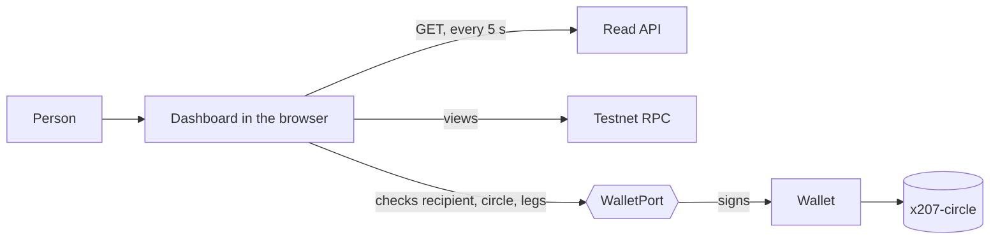

The dashboard is where a person sees what the circle is doing. It is a React + Vite single-page app, live at [x207.vercel.app](https://x207.vercel.app). It is **testnet only**; mainnet is not live.

- `/` is the landing page. The dashboard itself starts at [x207.vercel.app/stats](https://x207.vercel.app/stats), and the in-app home is `/app`.
- An old dashboard link on the root with `?circle=` or `?epoch=` still opens the dashboard, at `/stats` with the query kept.
- The hosted build opens on the active circle: `agents-main` on contract `%ACTIVE_CONTRACT%` (read API `%ACTIVE_API%`). The circle list and the active one come from the umbrella's `docs/deployments.json`; `?circle=` picks another.
- It is read-only static hosting. Data comes from the hosted read API (polled every 5 seconds) and the public testnet RPC. The hosted read API answers the dashboard origin only (CORS).



Before the page signs a voucher it checks recipient, circle, canonical form and legs itself, so a lying server cannot change what the key signs.

## Pages

Routes are from `src/routes.tsx`. The sidebar groups them as below. Pages marked "per epoch" follow an epoch selector.

### Overview (public)

| Route | Title | Shows |
| --- | --- | --- |
| `/app` | Home | What x207 does, where your account stands, what to do next |
| `/stats` | Clearing results | How one epoch cleared: many vouchers in, a few net payments out (per epoch) |
| `/reports` | Epoch report | The record of one epoch member by member: owed, cancelled, paid (per epoch) |
| `/charts` | Who owes whom | Map of debts between members before and after loops cancel (per epoch) |
| `/risk` | Risk | Stakes, late payments, who covers a loss (per epoch) |

### My account (needs a wallet)

| Route | Title | Shows |
| --- | --- | --- |
| `/onboarding` | Join the circle | Step-by-step membership: test funds, registration, credit limit |
| `/settlement` | Pay and claim | What you owe or can claim after clearing, with the pay or claim button. Also the Intents balance and withdraw panels (per epoch) |
| `/settings` | Settings | Display name, email, payment reminders |

### Marketplace

These pages show their own sign-in card where a form needs a wallet.

| Route | Title | Shows |
| --- | --- | --- |
| `/marketplace` | Marketplace | Listings; trades are paid in credit and only the net is settled |
| `/invoices` | Invoices | Bill another member, in one payment or instalments |
| `/orders` | Service orders | Orders with milestones, confirmed on delivery |
| `/licenses` | Content licenses | Right to use a file; the file stays encrypted until paid |
| `/codes` | One-time codes | Single-use codes such as API credits, revealed only to the buyer |
| `/transfers` | Account transfers | Sell a domain, game item or ticket; payment held until the platform shows the transfer |
| `/rent` | Rent access | Rent access to an account by the day |
| `/access` | Access grants | Who holds which access right, until when. Read only |

### Governance and help

| Route | Title | Shows |
| --- | --- | --- |
| `/governance` | Governance | Rule changes proposed and voted in the Sputnik DAO that owns `x207-v013.testnet`. `x207-v018.testnet` is owned by a team account, not a DAO. Read only |
| `/help` | Help | How x207 works in four steps, and a glossary |

Also: `/sign` is the popup page of the optional Privy wallet. The old Indonesian paths (for example `/statistik`, `/laporan`, `/risiko`) redirect to the English routes with the query kept. Any other path shows "This page does not exist".

On the hosted circle the marketplace lists (listings, invoices, orders) are empty and say so. The pages for licenses, codes, transfers and rent are forms for a signed-in wallet.

## Connect a wallet

Pages that sign need a wallet. The app uses the NEAR Connect library (`@hot-labs/near-connect`) to open a wallet selector. An optional Privy wallet is offered only when the build sets `VITE_PRIVY_APP_ID`; otherwise it is simply not shown. The session is remembered in the browser only. Without storage it does not survive a reload.

Honest limit: the project documents that a real wallet through NEAR Connect has **not been tried** on the hosted deployment. Treat wallet signing there as unverified.

## Join the circle

1. Open `/onboarding` and connect a wallet.
2. Follow the steps on the page: test funds, registration, and your credit limit. The stake is a mock USDT test token with no value.
3. If you hold another asset, the page can request a 1Click quote for a swap into USDT through NEAR Intents. Job states are shown on the page, ending at `ready_withdraw`. This path needs the hosted read API. Only a dry quote has run; no swap through Intents has moved funds.
4. Pay any residual in the payment window at `/settlement`. A buyer that does not pay inside the window defaults: its stake is cut and the member is `suspended`.

The command-line route, with two agent accounts and an MCP tool, is in the join guide linked below. Exit: the exit panel sends `request_exit`; after the epoch is finalized, "Withdraw stake" sends `withdraw_stake` and the status becomes `exited`. That flow is tested against near-sandbox with the wallet replaced by a mock.

## Run it locally

Needs Node 22.22.2 or newer.

```bash
cp .env.example .env
npm ci
npm run dev        # http://localhost:5207
```

Set `VITE_X207_USE_FIXTURES=true` for sample data without a backend. A local page cannot read the hosted read API (CORS), so for live data run the read API from the backend repository and point `VITE_X207_API_URL` at it.

Public build variables (no secrets): `VITE_X207_API_URL`, `VITE_X207_CIRCLE`, `VITE_X207_CONTRACT_ID`, `VITE_NEAR_NETWORK`, `VITE_X207_POLL_MS`, `VITE_X207_USE_FIXTURES`, `VITE_PRIVY_APP_ID`, `VITE_PRIVY_APP_CLIENT_ID`. The content security policy is built from `VITE_X207_API_URL`, so set it at build time.

Other commands: `npm run build`, `npm test` (Vitest), `npm run test:e2e` (Playwright), `npm run lint`.

## Source

- [frontend/README.md](https://github.com/x207-labs/frontend/blob/main/README.md)
- [frontend/src/routes.tsx](https://github.com/x207-labs/frontend/blob/main/src/routes.tsx)
- [frontend/src/App.tsx](https://github.com/x207-labs/frontend/blob/main/src/App.tsx)
- [frontend/src/wallet/nearConnect.ts](https://github.com/x207-labs/frontend/blob/main/src/wallet/nearConnect.ts)
- [frontend/src/components/DepositBranch.tsx](https://github.com/x207-labs/frontend/blob/main/src/components/DepositBranch.tsx)
- [frontend/.env.example](https://github.com/x207-labs/frontend/blob/main/.env.example)
- [docs/join-the-circle.md](https://github.com/x207-labs/x207/blob/main/docs/join-the-circle.md)
