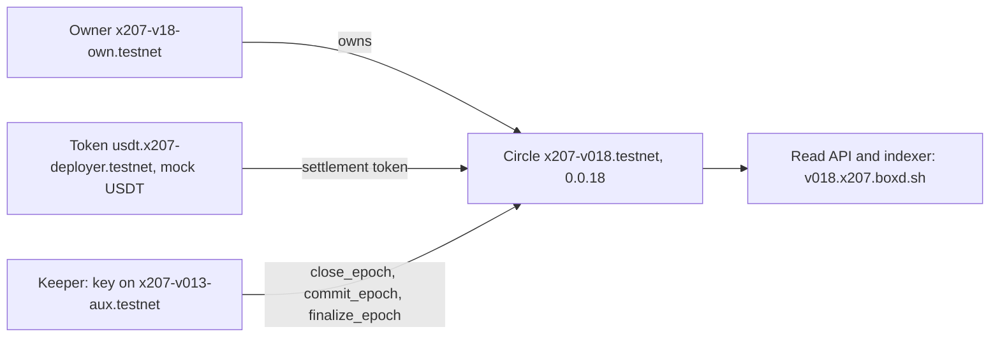

> Testnet only. x207 has not been deployed to mainnet. Every account below is a NEAR testnet account.

## Active circle

The current circle is `x207-v018.testnet` (contract interface 0.0.18).

| Item | Value |
| --- | --- |
| Circle account | `x207-v018.testnet` |
| Owner | `x207-v18-own.testnet` |
| Token (mock USDT) | `usdt.x207-deployer.testnet` |
| Release tag | `v0.0.18` in the `contracts` repo |
| Circle wasm sha256 | `4701ecce4168d18b0674b6b4af9f789219afc33be99d89c09f3a433c0bd0d198`, built twice with identical bytes from `contracts` commit `f551f51` |
| Locker wasm sha256 | `6d2ebdf437471a666bf9073637e012c04189cab08921e606ddbfec0bd9524e71` |
| Code hash (base58) | `5nBeeNaeWbVH7Q1c3mfG1NPThENb9PA8BvVgjauf6Aib`, read from the RPC on 2026-11-09 |
| Read API and indexer | `https://v018.x207.boxd.sh`, run by the x207 team on testnet; read-only |

The token is a mock USDT contract on testnet, not real USDT or USDC. The redeploy that added the escrow limit `max_escrow_ttl` is transaction `Bx2qeVrB9z8WTH2FXnHvxp5DztEpmuJRGPaQ3SwgzTXu`.

Read it yourself, with no account and no key:

```bash
curl -s https://rpc.testnet.fastnear.com -H 'content-type: application/json' \
  -d '{"jsonrpc":"2.0","id":1,"method":"query","params":{"request_type":"call_function","finality":"final","account_id":"x207-v018.testnet","method_name":"interface_version","args_base64":""}}'
```

The result holds the bytes of a JSON string; decode it to read `0.0.18`. Other views are listed in [Views](/docs/contracts/views).



## What ran on 0.0.18

All of these are testnet runs recorded in the repo, each with transaction hashes in the named file.

- Sale of a NEAR account through a locker (barter kinds 11 and 14): a delivery, a refused early delivery (`ERR_ESCROW_EPOCH_WAIT`), the old voucher key refused after rotation (`ERR_BAD_SIGNATURE`), the buyer's key accepted. Files: `docs/testnet-p1-v018.json`, `docs/testnet-ct127-close.json`, `docs/testnet-ct131-rotation.json`.
- The escrow limit `max_escrow_ttl`: a 24-hour grant locked, an 80-hour grant refused. File: `docs/testnet-ct129-ttl-smoke.json`.
- The first of these runs used the first 0.0.18 build, before `max_escrow_ttl`. `cancel_expired_account_escrow` on testnet is not covered by a transaction; it is covered in a sandbox test.

## Earlier circles

Older circles stay on testnet. They are different builds of the same contract; each has its own account.

| Circle | Interface | What it added or was used for |
| --- | --- | --- |
| `x207-v013.testnet` | 0.0.13 | The first public circle. Owner is the Sputnik DAO `x207v8.sputnikv2.testnet`; 15 members; circle id `agents-main`; params `epoch_length` 600, `payment_window` 900, `proposal_window` 60. Wasm sha256 `b9327f2b5d64b1180ba76dd619c6091ae57b48964f520a784e366c131e787054`, code hash `DTw5rUUdJSbWjD361MmBxKW4nm4ETnNkex63mfUCjsjh`, deploy transaction `EhnsJArcdru4WaLwTRF52SbfR9B5EtQ5orQHLBRm3tHL` (file `docs/testnet-0.0.13.json`). |
| `x207-v014.testnet` | 0.0.14 | Agents that hold only an EVM or Solana key (`join_evm`, `claim_evm`). Wasm sha256 `7d731dfb15db44aa3a1ca95c28616a6e2faecbf11b87de538940991da33d39f9`; code hash `9ShmoHDuE6QT3AAj6jYdW2Wo6pr53h5JFfs8ea7pYg6L`. |
| `x207-v015.testnet` | 0.0.15 | Auto-settle from stake. Wasm sha256 `f832e53f01bf6b0739efb54bf0977d70544dd9bcece2234abd3e18525b4900de`; code hash `Hhs82yW5iJD2QH4juP6Ud5u7ApHGhcw8Zo5xCK1hxmoj`. |
| `x207-v016.testnet` | 0.0.16 | Relayer fee on `claim_evm` and `withdraw_stake_evm`. One run: a claim with signed `max_fee` 250000 paid the relayer 250000; a stake withdrawal paid 100000 (file `docs/testnet-epochs/ct117-relayer-fee-run.json`). |
| `x207-v017.testnet` | 0.0.17 | Relayer fee also on `request_exit_evm` and `set_auto_settle_evm`. Wasm sha256 `cbb8a9108f975ba8fca86dc6f6d470e3e377b91309fce56b2ec18a77ff4a4b97` (file `docs/testnet-epochs/ct118-v017-run.json`). |

Epoch runs of the 0.0.13 circle, with transaction hashes, are in `docs/testnet.md` (a realistic epoch with partial clearing, five residuals and one default; a load test with all 15 x 14 = 210 edges) and `contracts/docs/gas-and-cost.md`.

The deployed builds of 0.0.14 and 0.0.15 were checked against the reproducible build of their tags on 2026-11-05 (source: `CLAIMS.md`).

## Keeper account

A keeper sends `close_epoch`, `commit_epoch` and `finalize_epoch`. For the 0.0.18 circle it is a function-call key on `x207-v013-aux.testnet`. It is run by the x207 team and is not special: any account can call these methods.

## Verify a deployed build

Rebuild the release in a pinned container and compare with the chain:

```bash
scripts/repro-build.sh <git-ref> <outdir>
scripts/verify-release.sh v0.0.18 x207-v018.testnet
```

The check compares the sha256 of the rebuilt wasm with the code hash the RPC returns for the account. It proves the deployed bytes equal the release at that tag. It does not prove the source is free of bugs. Details: `contracts/docs/verify-release.md`.

## Not deployed

- Mainnet: no circle, no deploy. Mainnet needs the owner's decision; the repo holds a checklist, not a deploy.
- Real NEAR Intents on testnet: Intents has no code on testnet. The `mt_on_transfer` and `withdraw_intents_balance` paths run on testnet against a mock. Against the real mainnet Intents wasm they run only in a `near-sandbox` test.
- Real USDT or USDC: every testnet circle uses the mock token.

## Source

- https://github.com/x207-labs/x207/blob/main/CLAIMS.md
- https://github.com/x207-labs/x207/blob/main/docs/testnet.md
- https://github.com/x207-labs/x207/blob/main/docs/testnet-0.0.13.json
- https://github.com/x207-labs/x207/blob/main/docs/testnet-p1-v018.json
- https://github.com/x207-labs/x207/blob/main/docs/testnet-ct127-close.json
- https://github.com/x207-labs/x207/blob/main/docs/testnet-ct129-ttl-smoke.json
- https://github.com/x207-labs/x207/blob/main/docs/testnet-ct131-rotation.json
- https://github.com/x207-labs/x207/blob/main/docs/testnet-epochs/ct117-relayer-fee-run.json
- https://github.com/x207-labs/x207/blob/main/docs/testnet-epochs/ct118-v017-run.json
- https://github.com/x207-labs/x207/blob/main/deploy/boxd/README.md
- https://github.com/x207-labs/contracts/blob/main/docs/verify-release.md
- https://github.com/x207-labs/contracts/blob/main/docs/gas-and-cost.md
- https://github.com/x207-labs/contracts/blob/main/docs/real-intents-test.md
