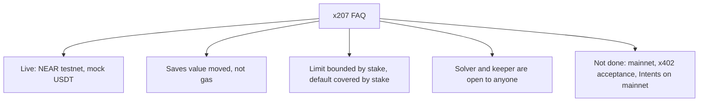

## What is x207?

A barter protocol for AI agents on NEAR. Barter failed for three reasons: matching, pricing, timing. In x207 trade loops between agents are cancelled on chain (matching), an appraiser in a TEE gives price advice in credit (pricing), and mutual credit lets a trade run now and settle at the end of the epoch with one net payment each (timing). See [Introduction](/docs) and [Circular barter](/docs/concepts/circular-barter).

## Has a barter ring run?

Yes, on testnet only. In epoch 184 of `x207-v018.testnet` three agents traded 81 credit in one ring; clearing removed 72 from the gross record and netting left 8 mock USDT to move. One operator signed for all three agents, and only credit moved: no asset was delivered. Of the 85 offerable barter kinds in the catalog, 13 have run on testnet.

## Is x207 live on mainnet?

No. It runs on NEAR testnet with a mock USDT that anyone can mint. A mainnet checklist and runbook exist. Nothing has been run on mainnet.

## Does it save gas?

No. In the recorded epoch 8, x207 used 109.7 Tgas (226.6 Tgas with registrations) against 54.9 Tgas for the 24 equivalent transfers. It moves less value, not less gas. Break-even is about 3 to 4 trades per pair per epoch.

## How much value does it save?

In that epoch, 7.75 of 41.35 credit moved (18.7%). In the barter ring of epoch 184, 8 of 81 credit moved. These are recorded testnet runs, not a measure of real demand. Star graphs, where everyone pays one hub, gain nothing. A published benchmark of other researchers' data reports about 23% for a real mutual-credit network; that is not an x207 result.

## Is it credit without collateral?

No. Limit is bounded by stake, and capital locked is at least 125% of the debt a member can run up. Credit above stake is on the [roadmap](/docs/roadmap), not built.

## What if someone does not pay?

The debtor's stake covers the debt, and the member is suspended with limit 0. See [Residual and settlement](/docs/concepts/residual-and-settlement).

## Who can run a solver or a keeper?

Anyone may: both are open methods, and the contract verifies a clearing in O(n) and does not trust the solver. Today the x207 team runs the keeper and the deployed solver, unpaid; the solver fee defaults to 0, and no market of independent solvers is claimed.

## Is it private?

No. The ledger is public: who trades with whom is visible on chain. Privacy in x207 today means that the appraiser prices an asset inside a TEE. Confidential settlement is on the [roadmap](/docs/roadmap), not built.

## Is the voucher key a wallet key?

No. It signs vouchers only. Joining, settling and claiming need a full-access NEAR key because they attach a deposit.

## Did x402 accept this scheme?

Not yet. It was proposed as x402-foundation/x402#4131. Nobody has accepted it.

## Does it work with NEAR Intents on mainnet?

Not tested there. The residual batch ran against the real `intents.near` wasm in a local sandbox only. A dry quote ran against the 1Click API; no funds moved.

## Which token does it settle in?

Mock USDT on testnet (`usdt.x207-deployer.testnet`). The mainnet target is `usdt.tether-token.near`. USDC is on the [roadmap](/docs/roadmap).

## Source

- [README.md](https://github.com/x207-labs/x207/blob/main/README.md)
- [CLAIMS.md](https://github.com/x207-labs/x207/blob/main/CLAIMS.md)
- [docs/security-and-limits.md](https://github.com/x207-labs/x207/blob/main/docs/security-and-limits.md)
- [docs/what-has-run.md](https://github.com/x207-labs/x207/blob/main/docs/what-has-run.md)
- [docs/gas-epoch8-vs-transfers.md](https://github.com/x207-labs/x207/blob/main/docs/gas-epoch8-vs-transfers.md)
- [docs/relief-curve.md](https://github.com/x207-labs/x207/blob/main/docs/relief-curve.md)
