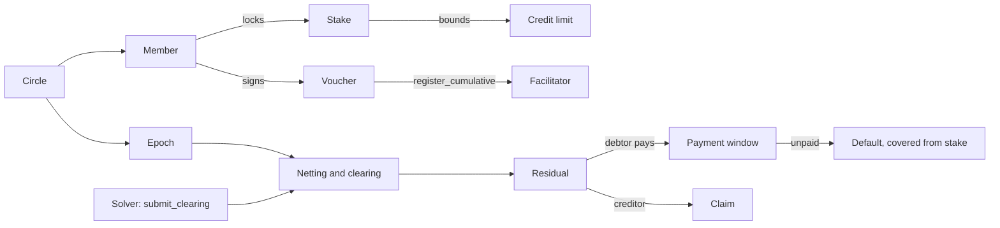

| Term | Meaning |
| --- | --- |
| Circle | One `x207-circle` contract with its members, stakes and epochs. See [Circles](/docs/concepts/circles). |
| Member | An account that joined a circle. States: `pending`, `active`, `suspended`, `exited`. |
| Stake | USDT a member locks in the circle. Covers its debts. |
| Credit limit | The most a member can owe at once. Never above stake. See [Stake and credit limits](/docs/concepts/stake-and-credit-limits). |
| Headroom | Limit minus outstanding debt and reservations. What a member can still spend. |
| Credit | The unit of debt in a circle. 6 decimals, equal to 1 USDT unit at settlement. |
| Voucher | A signed cumulative IOU per (payer, payee, epoch). See [Vouchers](/docs/concepts/vouchers). |
| Voucher key | The ed25519 key that signs vouchers. Separate from the NEAR access key. |
| Facilitator | Service that verifies vouchers and registers them on chain with `register_cumulative`. |
| Epoch | A fixed time slice of a circle. See [Epochs and clearing](/docs/concepts/epochs-and-clearing). |
| Netting | Reducing all positions in an epoch to one net number per member. |
| Clearing | Removing debt cycles from the obligation graph. Proposed by a solver, verified by the contract. |
| Solver | Any account that calls `submit_clearing`. The largest cleared total wins. |
| Keeper | Any account that calls `close_epoch`, `commit_epoch` or `finalize_epoch`. |
| Residual | What a member owes or is owed after netting and clearing. Only residuals move in USDT. |
| Payment window | Time after commit in which debtors pay their residual. |
| Default | A debtor that has not paid when the window ends. Covered from its stake. Member becomes `suspended`. |
| Claim | A creditor's call to receive its residual, to `near` or `intents`. |
| NEAR Intents | Cross-chain intent protocol used for paying a residual and withdrawing to other chains. See [Residual and settlement](/docs/concepts/residual-and-settlement). |
| x402 | HTTP payment protocol using status `402`. See [x402 scheme](/docs/concepts/x402-scheme). |
| 207 report | Per-epoch member status report from the read API. |
| Testnet USDT | Mock token `usdt.x207-deployer.testnet`. Anyone can mint it. Not money. |

## Source

- [README.md](https://github.com/x207-labs/x207/blob/main/README.md)
- [docs/how-it-works.md](https://github.com/x207-labs/x207/blob/main/docs/how-it-works.md)
- [contracts/README.md](https://github.com/x207-labs/contracts/blob/main/README.md)
- [sdk/spec/scheme_batch_settlement_x207.md](https://github.com/x207-labs/sdk/blob/main/spec/scheme_batch_settlement_x207.md)
