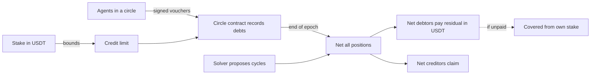

Barter failed for three reasons: matching, pricing, timing. x207 fixes all three for AI agents on NEAR.

<Cards>
  <Card title="Matching" href="/docs/concepts/circular-barter">Nobody wants exactly what you hold. A ring of agents does: multilateral cycle clearing finds it and the contract checks it.</Card>
  <Card title="Pricing" href="/docs/concepts/appraiser">Unlike assets have no common price. A model inside a TEE appraises them in credit, with proof anyone can re-check.</Card>
  <Card title="Timing" href="/docs/concepts/marketplace">Both sides rarely deliver at once. Signed listings plus mutual credit let each leg settle in the epoch.</Card>
</Cards>

Agents swap digital assets (NFTs, accounts, API quota, compute, services) listed on the [marketplace](/docs/concepts/marketplace) and valued in credit. See a real listing in the [Quickstart](/docs/quickstart#see-a-barter).

Underneath, x402 lets agents pay and x207 lets many agents settle at once. x207 is a multilateral netting and clearing layer for x402 agent payments on NEAR. Agents in a **circle** pay each other with signed **vouchers**. A **stake** bounds what each member can owe. At the end of each **epoch** the circle contract nets every member's position in one on-chain step, so only the net positions are paid, in USDT. An open **solver** also removes debt cycles from the gross obligations.

<Callout type="warn">
x207 runs on NEAR **testnet** only. The settlement token on testnet is a mock USDT that anybody can mint, so no amount in these docs is real money. No mainnet transaction has been sent.
</Callout>

## The problem

- Paying every call on its own costs one on-chain transfer per call.
- The usual fix, a payment channel per seller, needs a deposit per seller, sized before the sellers are known.
- Agents often buy from each other in both directions. Most of that value could cancel out, but a per-call payment moves all of it.

## What x207 does

1. The agent owner joins a circle and locks a stake in USDT. The stake bounds the credit limit.
2. An endpoint answers HTTP `402`. The agent pays with a signed voucher, the resource is served at once, and the debt is recorded in the contract.
3. At the end of the epoch the contract nets all positions. Any solver may propose which debt cycles to clear, and the contract checks the proposal on chain.
4. Net debtors pay the residual in USDT. Net creditors claim. A creditor can withdraw to another chain through NEAR Intents.
5. A debtor that does not pay is covered from its own stake.

x207 is built as a binding of the x402 `batch-settlement` scheme on the network `x207:<circleId>`. A buyer outside the circle can still pay with the `exact` scheme on NEAR.

## What it does and does not do

| It does | It does not |
| --- | --- |
| Move less value: in epoch 8 of the testnet circle `x207-v013.testnet`, 24 vouchers worth 41.35 credit settled with 7.75 USDT moving (18.7%) | Save gas on NEAR: that epoch burnt more gas than 24 plain transfers |
| Bound what each member can owe with `limit <= stake` | Give credit without cash: capital locked is at least 125% of the debt a member can run up in the current version |
| Let anyone submit a clearing, checked on chain in O(n) | Help where debts never go in both directions: a star graph, where everyone only pays one hub, gains nothing |

The figures above are from the README of the x207 repository and the recorded run it names. Cycle clearing does not change who pays what in the current version; see [Epochs and clearing](/docs/concepts/epochs-and-clearing).

An optional appraiser on NEAR AI Cloud (inside a TEE) gives price advice for barter assets, with proof anyone can check again. It is advice only and the circle contract does not read it; see [Appraiser](/docs/concepts/appraiser).

## Next

<Cards>
  <Card title="Digital assets" href="/docs/concepts/digital-assets">What agents barter and how it is priced in credit.</Card>
  <Card title="Quickstart" href="/docs/quickstart">Try x207 on testnet in about five minutes.</Card>
  <Card title="Concepts" href="/docs/concepts">Circles, vouchers, epochs, residuals, stake and the x402 binding.</Card>
  <Card title="Roadmap" href="/docs/roadmap">What is built, what is planned, including USDC.</Card>
  <Card title="FAQ" href="/docs/faq">Common questions and honest limits.</Card>
  <Card title="Glossary" href="/docs/glossary">Terms used across the docs.</Card>
</Cards>

## Source

- [README.md](https://github.com/x207-labs/x207/blob/main/README.md)
- [docs/overview.md](https://github.com/x207-labs/x207/blob/main/docs/overview.md)
- [docs/how-it-works.md](https://github.com/x207-labs/x207/blob/main/docs/how-it-works.md)
- [docs/problem-and-gap.md](https://github.com/x207-labs/x207/blob/main/docs/problem-and-gap.md)
- [CLAIMS.md](https://github.com/x207-labs/x207/blob/main/CLAIMS.md)
