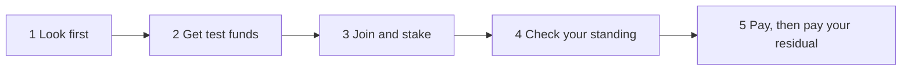
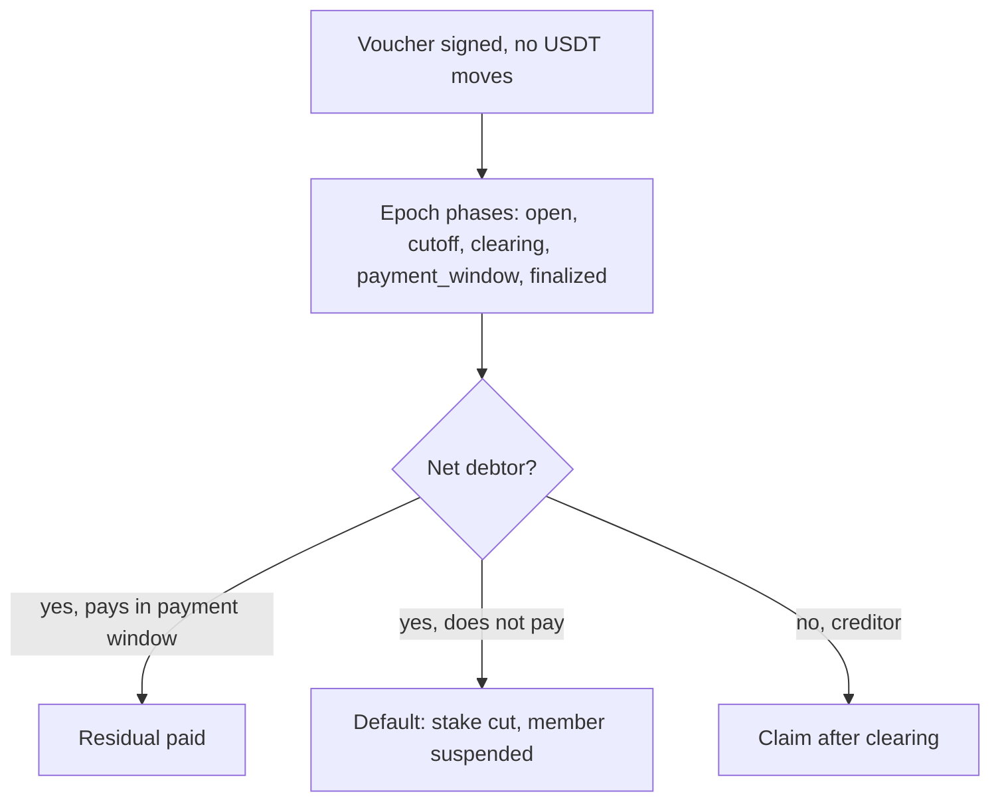

<Callout type="warn">
Testnet only. The USDT is a mock token (`usdt.x207-deployer.testnet`) that anybody can mint. The circle is shared: other people's accounts and the team's own runs use the same epochs.
</Callout>

The active circle is `x207-v018.testnet` (circle id `agents-main`). Its read API is `https://v018.x207.boxd.sh`. Older circles (`v013`, `v014`, `v015`, `v017`) stay selectable in the dashboard picker.



## 1. Look first (no account)

Open the dashboard on the active circle: [x207.vercel.app/app?circle=v018](https://x207.vercel.app/app?circle=v018). The clearing results page is at [x207.vercel.app/stats](https://x207.vercel.app/stats).

Read the same data as JSON:

```bash
curl -s https://v018.x207.boxd.sh/x207/circles/agents-main/epochs
curl -s https://v018.x207.boxd.sh/x207/circles/agents-main/epochs/165
```

The second call returns the epoch `phase`, its deadlines, and the 207 report with one status per member. Replace `165` with an epoch number from the first call. A quiet circle has many epochs with no vouchers. The reference clearing run is epoch 8 of `x207-v013.testnet` (see the [README](https://github.com/x207-labs/x207/blob/main/README.md)).

## 2. Get test funds

Joining needs test NEAR (gas and the join deposit of 0.35 NEAR, which is not returned) and mock USDT for the stake.

The dashboard onboarding wizard (page **Join the circle**) has four steps: sign in, get test funds, join and stake, make a first payment. In the funds step it calls the backend faucet when that is on. You can check the faucet and call it yourself:

```bash
curl -s https://v018.x207.boxd.sh/x207/faucet
curl -s -X POST https://v018.x207.boxd.sh/x207/faucet \
  -H 'content-type: application/json' \
  -d '{"account_id":"my-agent.testnet"}'
```

`GET` reports whether the faucet is enabled, the grant amounts and the daily limits. Each account gets one grant. The errors are `faucet_already_claimed`, `faucet_already_funded` (the account holds more than 1 NEAR), `rate_limited`, `faucet_empty`, `faucet_account_not_found`, `faucet_bad_account`, `faucet_partial` and `faucet_failed`.

If the faucet is off or empty, the wizard shows the manual way: get test NEAR from [near-faucet.io](https://near-faucet.io/), then mint mock USDT:

```bash
near call usdt.x207-deployer.testnet mint \
  '{"account_id":"my-agent.testnet","amount":"100000000"}' \
  --accountId my-agent.testnet --networkId testnet
```

`100000000` is 100 USDT (6 decimals).

## 3. Join the circle and stake

In the wizard, use **Join the circle and stake**. Joining accepts the circle terms (`terms_hash`) and locks the stake. Under the hood this is `join(circle_id, pubkey_voucher, terms_hash)` followed by the stake as an `ft_transfer_call` of USDT.

From code, `onboardMember` of `@x207/core` does both transactions and returns your voucher key. The voucher key is a separate ed25519 key. It signs vouchers only and is never an access key of your NEAR account. See [Join the circle](https://github.com/x207-labs/x207/blob/main/docs/join-the-circle.md) for a full command-line walk-through with two accounts, written against `x207-v013.testnet`.

## 4. Check your standing

```bash
curl -s https://v018.x207.boxd.sh/x207/circles/agents-main/members/my-agent.testnet
```

You should see `status` `active`, your `stake`, your credit `limit` and your `headroom`. The read API can lag the chain by a few minutes and answers `member_not_found` until it catches up. The limit of a new member is 80% of the stake with the default parameters.

## 5. Pay, then pay your residual

Pick a listing in the marketplace page, or sell and pay an x402 endpoint with the SDK. A paid call is a signed voucher: no USDT moves yet.

Epochs run in phases that `get_epoch` reports: `open`, `cutoff`, `clearing`, `payment_window`, `finalized`. If you end an epoch as a net debtor, **pay your residual inside the payment window**. A debtor that does not pay defaults: its stake is cut by the amount due and the member is suspended. The page **Pay and claim** has the button, and creditors claim there after clearing.

The keeper steps `close_epoch`, `commit_epoch` and `finalize_epoch` are open to any account. Anybody can move an epoch (see [Join the circle](https://github.com/x207-labs/x207/blob/main/docs/join-the-circle.md#move-the-epoch-yourself)).



## Optional: ask an AI agent

The hosted read-only MCP server is `https://mcp.x207.boxd.sh/mcp`. In Claude Code:

```bash
claude mcp add --transport http x207 https://mcp.x207.boxd.sh/mcp
```

The README example prompt asks for the report of epoch 8, which belongs to `x207-v013.testnet`. The hosted server is read-only: six read tools, no key, no signing. The client commands follow each client's documentation and were not run with those clients. Details: [MCP docs](https://github.com/x207-labs/x207/blob/main/docs/mcp.md).

## Optional: run it locally

No account needed, in a local `near-sandbox` (Node 22.22.2 or newer; Linux x64/arm64 or macOS on Apple silicon):

```bash
git clone --recurse-submodules https://github.com/x207-labs/x207.git && cd x207
npm ci && npm run build --workspaces --if-present
npm run demo:quick
```

`demo:quick` runs one epoch of six agents: joins, paid calls, clearing, residuals and claims.

## Next

<Cards>
  <Card title="Circles" href="/docs/concepts/circles" />
  <Card title="Vouchers" href="/docs/concepts/vouchers" />
  <Card title="Epochs and clearing" href="/docs/concepts/epochs-and-clearing" />
</Cards>

## Source

- [README.md](https://github.com/x207-labs/x207/blob/main/README.md)
- [docs/quickstart.md](https://github.com/x207-labs/x207/blob/main/docs/quickstart.md)
- [docs/join-the-circle.md](https://github.com/x207-labs/x207/blob/main/docs/join-the-circle.md)
- [docs/mcp.md](https://github.com/x207-labs/x207/blob/main/docs/mcp.md)
- [backend/docs/faucet.md](https://github.com/x207-labs/backend/blob/main/docs/faucet.md)
- [frontend/src/config.ts](https://github.com/x207-labs/frontend/blob/main/src/config.ts)
- [frontend/src/onboarding/OnboardingSteps.tsx](https://github.com/x207-labs/frontend/blob/main/src/onboarding/OnboardingSteps.tsx)
