<Callout type="warn">
Everything under Planned is not built. Dates are not promised.
</Callout>

## Built (testnet)

- Barter bundles (`commit_bundle`): a three-agent ring ran in epoch 184 of `x207-v018.testnet`, one operator, credit only: that bundle ring delivered no asset. A second ring (epoch 245 of the same account, circle `agents-main`) delivered three mock NFTs through contract escrow, with three separate `complete_escrow` transactions and not one bundle. 13 of 85 offerable barter kinds have run on testnet.
- Marketplace book of signed listings and offers, off chain, run by the x207 team.
- Appraiser on NEAR AI Cloud inside a TEE, with stored proof. Advice only.
- Circle contract with stake, vouchers, epochs, cycle clearing, residual payment, claim and default handling.
- Facilitator and read API, 207 report, faucet, hosted read-only MCP server.
- Dashboard at [x207.vercel.app](https://x207.vercel.app).
- Opt-in auto-settle from stake.

```mermaid
flowchart LR
  B["Built on testnet"] --> P["Planned, not built, no dates"]
  P --> U["USDC: new circle, not started"]
  P --> MN["Mainnet: checklist only"]
  P --> CI["Circles: multiple circles, credit above stake, confidential settlement"]
  P --> CL["Clearing: path-based solver, multi-transaction, many pairs per transaction, keeper and solver fees"]
  P --> EC["Ecosystem: x402 scheme upstream, barter and marketplace, optional NEAR resources evaluation"]
```

## Planned

### USDC

The settlement token is mock USDT on testnet, with `usdt.tether-token.near` as the mainnet target. The plan is native Circle USDC (6 decimals). A circle's token is fixed at `new`, so the move means a new circle with `usdt_token_id` set to USDC, and members stake again. The field `usdt_token_id` and the error `ERR_ESCROW_USDT` keep their names. It also needs SDK config, a backend Intents asset `nep141:<usdc>`, faucet changes and the new contract id in the dashboard. Status: not started, planned after the hackathon.

### Mainnet

A deploy checklist and runbook exist. Nothing has been run. It needs explicit owner approval.

### Circles

- Multiple circles and clearing across circles.
- Credit above stake, backed by a reserve fund and a haircut to creditors.
- Confidential settlement through Confidential Intents.

### Clearing

- A path-based solver, which needs a new contract proof rule.
- Clearing spanning several transactions, to lift the 300-edge limit of `submit_clearing`.
- Registering many pairs in one transaction.
- Keeper reward and solver fee incentives. The fee parameters exist and default to 0.

### Ecosystem

- Upstream acceptance of the x402 scheme (proposal x402-foundation/x402#4131, open).
- Barter and marketplace features with real counterparties, real delivery of asset classes, and a book run by more than one operator. Today these have sandbox or limited evidence only.
- Evaluation of optional NEAR resources. This is evaluation, not a plan.

## Source

- [README.md](https://github.com/x207-labs/x207/blob/main/README.md)
- [docs/metrics-and-roadmap.md](https://github.com/x207-labs/x207/blob/main/docs/metrics-and-roadmap.md)
- [docs/roadmap-resources.md](https://github.com/x207-labs/x207/blob/main/docs/roadmap-resources.md)
- [docs/barter-evidence.md](https://github.com/x207-labs/x207/blob/main/docs/barter-evidence.md)
- [docs/security-and-limits.md](https://github.com/x207-labs/x207/blob/main/docs/security-and-limits.md)
