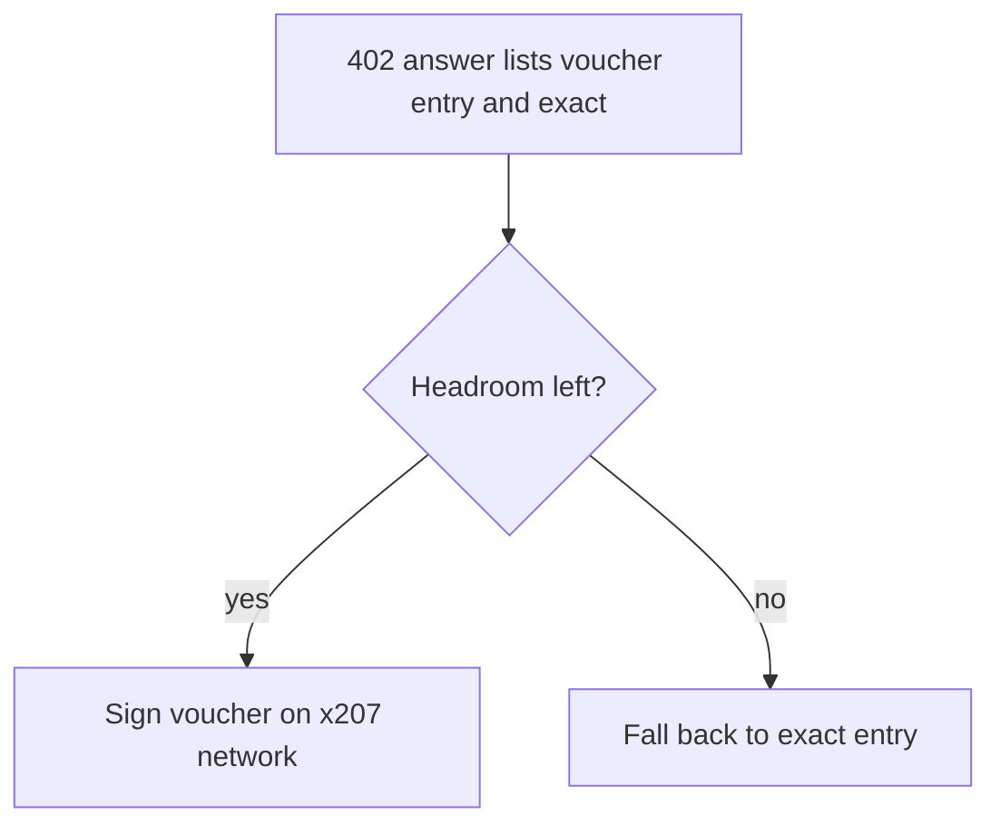
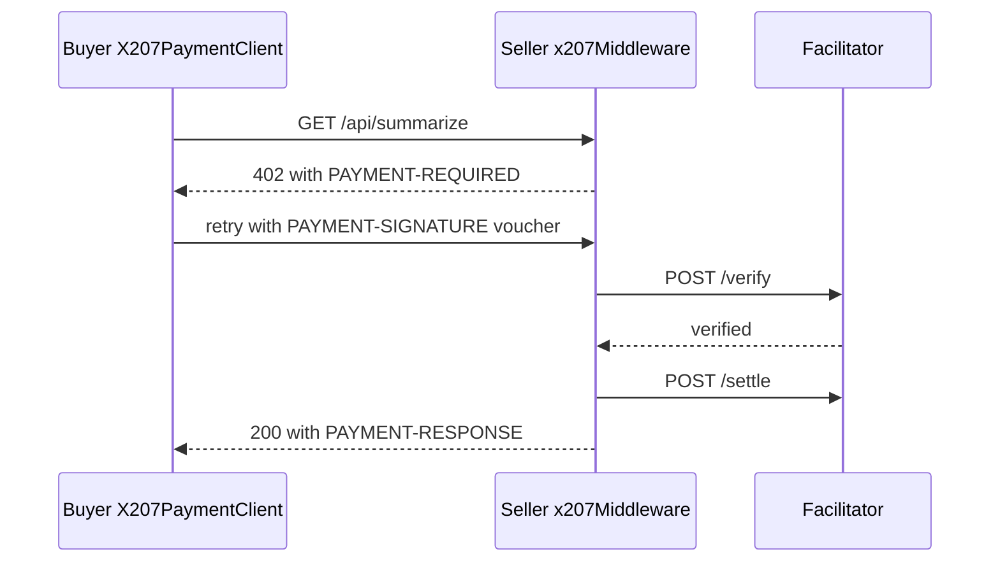

The SDK lets an x402 agent pay and sell on credit inside an x207 barter circle without knowing NEAR. It implements the x402 `batch-settlement` scheme on the network `x207:<circleId>`.

<Callout type="warn">
x207 runs on NEAR **testnet** only. Mainnet is not live. Everything below was written against the testnet circle and mock assets.
</Callout>

## Packages

| Package | npm version | What it is |
| --- | --- | --- |
| `@x207/core` | 0.0.3 | Voucher types and signing, client helpers for the `x207-circle` contract, NEP-297 event parser, `onboardMember`, and formats for barter, invoices, orders, licenses, access rent |
| `@x207/scheme` | 0.0.3 | x402 binding per role: `client`, `server`, `facilitator` |
| `@x207/mcp` | 0.0.7 | MCP server (bin `x207-mcp`): read tools by default, signs nothing |

These versions are the ones in each `package.json` in the repository, and `npm view` returns the same versions on the public registry. The reference facilitator (`apps/facilitator`) is an app in the repository, not an npm package you install.

Requires Node 22.22.2 or newer. All packages are ESM and Apache-2.0.

## Install

```bash
npm install @x207/core @x207/scheme @x402/fetch
```

For a seller, add the HTTP framework you already use; the middleware works on the standard `Request` and `Response`. To build from source instead:

```bash
git clone https://github.com/x207-labs/sdk
cd sdk
npm install
npm run build
npm test
```

`@x207/scheme` has the subpath exports `@x207/scheme/client`, `/server` and `/facilitator`. `@x207/core` has `@x207/core/signer`, `/signers` and `/evm`.

## Buyer: pay with vouchers

`secretKey` is the **voucher key**: one ed25519 key used only for vouchers, never a NEAR access key. Generate one with `generateVoucherKeypair()`.

```ts
import { wrapFetchWithPayment } from "@x402/fetch";
import { X207PaymentClient, headroomFromRpc } from "@x207/scheme";

const secretKey = process.env.X207_VOUCHER_KEY as `ed25519:${string}`;
const client = new X207PaymentClient({
  payer: "agent.near",
  secretKey,
  headroom: headroomFromRpc({}),
});
const paidFetch = wrapFetchWithPayment(fetch, client);
const response = await paidFetch("https://seller.example/api/summarize");
```

`X207PaymentClient` is an `x402Client` that has already registered `x207:*`. It uses the voucher while headroom lasts and falls back to the other entry of the `402` answer (normally `exact`) when headroom runs out. A `200` response carries the header `PAYMENT-RESPONSE`; `extensions.x207.registration` is `pending`, `retrying` or `registered`.



Already have an `x402Client`? Register the scheme yourself. This does not fall back to `exact` and does not check headroom:

```ts
import { x402Client } from "@x402/core/client";
import { X207SchemeClient } from "@x207/scheme";

const client = new x402Client().register(
  "x207:agents-main",
  new X207SchemeClient({ payer: "agent.near", secretKey }),
);
```

## Seller: one middleware

```ts
import { x207Middleware } from "@x207/scheme";

const paywall = x207Middleware({
  routes: { "GET /api/summarize": { price: "$0.02", description: "Summarize text" } },
  facilitatorUrl: "https://facilitator.example",
  circleId: "agents-main",
  payTo: "seller.near",
});
// paywall(request, next) => Promise of Response
```

The `402` answer then offers the voucher entry next to `exact`. The full example, including a Hono server and an optional second `exact` entry on Base Sepolia (`eip155:84532`, testnet USDC) for EVM buyers outside the circle via `alsoAccept`, is `examples/seller` in the repository. The x207 facilitator verifies and settles vouchers only; `alsoAccept` entries are verified and settled at the facilitator you name for them.

One voucher pays one request at a time: the middleware holds the commitment id after `/verify` and a parallel request with the same id gets `409 voucher_in_flight`. The default guard lives in the memory of one process; pass `inFlight` to share it across processes.



## Join a circle

```ts
import { onboardMember, createCircleViewFn } from "@x207/core";
import { createNearSender } from "@x207/core/signer";
```

`onboardMember(deps, input)` generates a voucher key (or reuses `secretKey`), calls `join` with the storage deposit, stakes with `ft_transfer_call`, and polls until the member is `active`. `deps` is `OnboardDeps`: `sendCall(call)`, `view`, and optional `pollIntervalMs` (default 1000), `timeoutMs` (default 60000). `input` is `OnboardInput`: `circleContract`, `circleId`, `accountId`, `termsHash`, `stakeAmount`, optional `secretKey`, `usdtTokenId`. It returns `OnboardResult`: `secretKey`, `publicKey`, `member`. Errors: `OnboardTimeoutError`, `StakeRejectedError`. `JOIN_STORAGE_DEPOSIT` is 0.35 NEAR. See the [quickstart](/docs/quickstart).

## API reference

Names below are exports found in the source. Signatures are abbreviated; the `.d.ts` files in each package are authoritative.

### `@x207/scheme` - client

| Export | Kind | Notes |
| --- | --- | --- |
| `X207PaymentClient` | class, extends `x402Client` | Options `X207PaymentClientOptions`: `payer`, one of `secretKey` or `signer`, `headroom` (a `HeadroomSource`), optional `store`, `bundleFor`, `spendLimit`, `accept`, `verifyResync`, `headroomCacheMs`, `now`. Properties `headroom`, `x207` |
| `X207SchemeClient` | class | Options `X207ClientOptions`: `payer`, exactly one of `secretKey` or `signer`, optional `store`, `confirmTimeoutMs` (default 60000), `bundleFor`, `spendLimit`, `meter`, `accept`, `verifyResync` |
| `headroomFromRpc(options?)` | function | `options`: `rpcUrls`, `fetch`. Returns a `HeadroomSource`, `(circleContract, payer) => Promise of string or null` |
| `HeadroomEstimator`, `selectX207Requirements`, `isX207Requirements` | class, function | Choose between the voucher and other `402` entries; cache 60 s (`HEADROOM_CACHE_MS`) |
| `SpendLimit`, `SpendLimitError` | type, class | `maxPerCall`, `maxPerEpoch` as decimal strings in the smallest credit unit; thrown before a voucher is signed |
| `NoPayableRequirementsError` | class | No entry of the `402` can be paid |
| `MemoryVoucherStateStore`, `VoucherStateStore`, `VoucherPairKey`, `VoucherState` | class, types | Per-pair `seq` and `cumulativeAmount`; supply your own store to survive restarts |
| `BuyerMeter`, `MeterOverbilledError` | class | Buyer-side count for metered endpoints |
| `DailyRent` | class | Buyer helper for access rent |

`accept` limits what a `402` may name: `circles`, `payees`, and `currentEpoch` (a function returning the open epoch or `null`). It is checked before anything is reserved or signed.

### `@x207/scheme` - server

| Export | Notes |
| --- | --- |
| `x207Middleware(options)` | Returns `X207Middleware`, `(request, next) => Promise of Response`. `X207MiddlewareOptions`: `routes`, `facilitatorUrl`, `circleId`, `payTo`, optional `alsoAccept`, `fetch`, `timeoutMs`, `extra`, `inFlight`, `maxHoldMs` |
| `X207RouteConfig` | `price` (string, number, or function for metered pricing), `maxQuantity`, `description`, `mimeType`, `grant`, `extensions` |
| `X207AlsoAccept` | `network`, `asset`, `payTo`, `facilitatorUrl`, optional `scheme`, `amount`, `maxTimeoutSeconds`, `extra` |
| `memoryInFlightGuard()`, `InFlightGuard` | Default in-process guard |
| `X207SchemeServer`, `buildPaymentRequirements` | Lower-level x402 server scheme |
| `EndpointAdapter` | Wraps an endpoint with the paywall (used by `examples/seller`) |
| `HEADER_PAYMENT_REQUIRED`, `HEADER_PAYMENT_SIGNATURE`, `HEADER_PAYMENT_RESPONSE` | `PAYMENT-REQUIRED`, `PAYMENT-SIGNATURE`, `PAYMENT-RESPONSE` |
| `MAX_TIMEOUT_SECONDS` | 60 |

The server module also exports metered-pricing and job helpers (`metering`, `metered-job`, `metered-endpoint`, `job-escrow`); see the source files.

### `@x207/scheme` - facilitator and shared

| Export | Notes |
| --- | --- |
| `X207SchemeFacilitator` | Options `X207FacilitatorOptions`: `network`, `circleContract`, optional `signers`, `verify`, `store`, `epochSource`, `now`. Without `verify`, `store` or `epochSource` the matching method throws `NotImplementedError` |
| `X207_SCHEME` | `"batch-settlement"` |
| `X207_NETWORK_FAMILY` | `"x207:*"` |
| `assertCircleId`, `defineCircleConfig`, `CircleIdError`, `NotImplementedError` | Network id helpers |

The reference facilitator app serves `POST /verify`, `POST /settle` and `GET /supported`. It also contains opt-in `POST /evm/*` relay routes (`join`, `claim`, `exit`, `withdraw`, `auto-settle`) for EVM agents.

### `@x207/core` - vouchers

| Export | Notes |
| --- | --- |
| `UnsignedVoucher` | `circle`, `payer`, `payee`, `epoch`, `seq`, `cumulativeAmount` (decimal string), `unit` (`"credit"`), `resource` |
| `Voucher` | `UnsignedVoucher` plus `signature` (`ed25519:...` or `eip712:0x...`) |
| `generateVoucherKeypair()` | Returns `secretKey` and `publicKey`, both `ed25519:<base58>` |
| `voucherPublicKey(secretKey)` | Public key of a voucher key |
| `signVoucher(voucher, secretKey)` | Returns a `Voucher` |
| `verifyVoucher(voucher, publicKey)` | Boolean |
| `serializeVoucherMessage`, `voucherPayload`, `voucherNonce`, `voucherSigningHash` | Canonical bytes; signing is NEP-413 style with tag `NEP413_TAG` |
| `ed25519Signer(secretKey)`, `VoucherSigner`, `signVoucherWith` | Pluggable signer; `@x207/core/evm` provides an EIP-712 signer for EVM agents |
| `CREDIT_DECIMALS`, `CREDIT_UNIT` | 6 and `"credit"` |

### `@x207/core` - contract, events, RPC

| Export | Notes |
| --- | --- |
| `createCircleViewFn(options)` | A `CircleViewFn`, `(methodName, args) => Promise of unknown`. Options: `circleContract`, `rpcUrls`, `fetch`, `timeoutMs`, `failover` |
| `createNearSender`, `createNearView`, `ContractCallError` | Transaction sender and view function; import from `@x207/core/signer` |
| `getMember`, `getOutstandingDebt`, `getAutoSettle` | Typed views |
| `buildJoinCall`, `buildStakeTransferCall`, `buildStakeMsg`, `buildRequestExitCall`, `buildWithdrawStakeCall`, `buildSetAutoSettleCall`, `buildRemoveIntentCall`, `buildWithdrawIntentsBalanceCall` | Build a `ContractCall` without sending it |
| `onboardMember` | See above |
| `parseEventLog(log)` | Parses `EVENT_JSON:` NEP-297 logs of standard `x207` into `X207Event` or `UnknownX207Event`; `isKnownX207Event` narrows. Types `X207EventMap`, `X207EventName` |
| `withRpcFailover(urls, run, options?)`, `TESTNET_RPC_URLS` | Failover over RPC endpoints |
| `contractErrorCode(error)` | Contract error code or `null` |

`@x207/core` also exports the signed-message formats and validators for barter and the marketplace (`barter`, `marketplace`), service orders (`order`), invoices (`invoice`), licenses (`license`), codes (`code`), transfers (`transfer`), access rent (`access`, `access-key`, `rent-check`) and the clearing hash (`clearing-hash`). See `packages/core/src`.

## MCP server

`@x207/mcp` lets an MCP client read a circle. The default build has six read tools (`x207_circle_overview`, `x207_member_inspect`, `x207_epoch_report`, `x207_simulate_clearing`, `x207_search_listings`, `x207_order_status`), all `readOnlyHint: true`.

```bash
X207_CIRCLE_CONTRACT=x207-v013.testnet X207_CIRCLE_ID=agents-main \
X207_BACKEND_URL=https://x207.boxd.sh npx -y @x207/mcp
```

| Variable | Meaning |
| --- | --- |
| `X207_CIRCLE_CONTRACT` | Required. Circle contract account |
| `X207_CIRCLE_ID` | Circle id in read API paths. Default `agents-main` |
| `X207_RPC_URL` | NEAR RPC endpoints, comma separated |
| `X207_BACKEND_URL` | Base URL of the [Read API](/docs/read-api). Without it the listing and order tools explain what is missing |
| `X207_TIMEOUT_MS` | Timeout per call, default 10000 |

Write tools (`x207_pay_request`, `x207_list_offer`, `x207_make_offer`, `x207_accept_offer`, `x207_confirm_milestone`, `x207_join`, `x207_settle`, `x207_claim`) exist only on stdio, are off unless `X207_MCP_WRITE=1`, and sit behind a session budget, a per-call price cap and a counterparty check. Streamable HTTP serves read tools only. The balance of the agent account is the largest possible loss: use a dedicated account.

As a library: `createX207McpServer(configFromEnv(), "stdio")`.

## Test locally

```bash
npm test                # unit tests
npm run conformance     # suite for other implementations of the binding
```

`npm run test:sandbox` needs a near-sandbox binary and the contract wasm. A Python conformance adapter exists under `python/`.

## Source

- [sdk README](https://github.com/x207-labs/sdk/blob/main/README.md)
- [`packages/core/package.json`](https://github.com/x207-labs/sdk/blob/main/packages/core/package.json)
- [`packages/scheme/package.json`](https://github.com/x207-labs/sdk/blob/main/packages/scheme/package.json)
- [`packages/scheme/client/select.ts`](https://github.com/x207-labs/sdk/blob/main/packages/scheme/client/select.ts)
- [`packages/scheme/client/index.ts`](https://github.com/x207-labs/sdk/blob/main/packages/scheme/client/index.ts)
- [`packages/scheme/server/middleware.ts`](https://github.com/x207-labs/sdk/blob/main/packages/scheme/server/middleware.ts)
- [`packages/scheme/facilitator/index.ts`](https://github.com/x207-labs/sdk/blob/main/packages/scheme/facilitator/index.ts)
- [`packages/core/src/voucher.ts`](https://github.com/x207-labs/sdk/blob/main/packages/core/src/voucher.ts)
- [`packages/core/src/contract/onboard.ts`](https://github.com/x207-labs/sdk/blob/main/packages/core/src/contract/onboard.ts)
- [`packages/core/src/contract/client.ts`](https://github.com/x207-labs/sdk/blob/main/packages/core/src/contract/client.ts)
- [`packages/core/src/events.ts`](https://github.com/x207-labs/sdk/blob/main/packages/core/src/events.ts)
- [`packages/mcp/README.md`](https://github.com/x207-labs/sdk/blob/main/packages/mcp/README.md)
- [`examples/seller/src/seller.ts`](https://github.com/x207-labs/sdk/blob/main/examples/seller/src/seller.ts)
- [`examples/buyer/src/buyer.ts`](https://github.com/x207-labs/sdk/blob/main/examples/buyer/src/buyer.ts)
