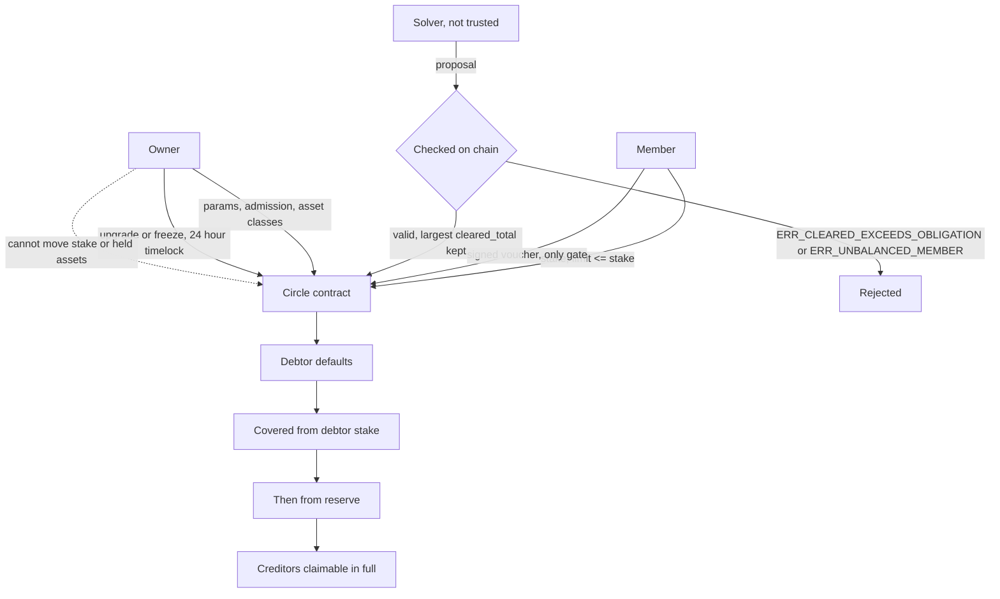

x207 is a testnet project. Its own reviews and tests are not an external audit. Nothing here says the system is safe; it says what was checked and what was not.

> Testnet only. No mainnet deploy has been made. Real funds should not be put into any x207 contract.

## Security model

**Who may attack.** A circle member who signs vouchers it will not honour or colludes with another member. Anyone who can call a public method or an HTTP endpoint (facilitator, read API, broker). A buyer or lessee of a grant. Whoever can influence text an agent reads.

**What is protected.**

- The stake of each member, and the rule `limit <= stake`, so every credit is backed by stake in the default model.
- The pool accounting against the USDT the circle holds.
- An NFT or account held in an escrow.
- The secret of a class C grantor.

**How the contract defends itself.**

- **Collateral first.** A member's limit is `min(limit_cap, stake * base_limit_ratio / 10000 + settled_history * limit_growth / 10000, stake)`. It grows only from residual paid in cash, so clearing a cycle does not raise a limit (this blocks wash trading between two accounts of one actor).
- **Loss order.** A default is covered from the debtor's stake, then from the reserve. Creditors are claimable in full. A later-phase haircut for losses beyond both exists as a design but is not applied.
- **Clearing is checked on chain.** A solver is not trusted. The contract verifies a proposal in one pass: no edge clears more than is owed (`ERR_CLEARED_EXCEEDS_OBLIGATION`) and each member's cleared inflow equals its outflow (`ERR_UNBALANCED_MEMBER`). It keeps the valid proposal with the largest `cleared_total`.
- **Signature as the only gate.** Voucher registration and EVM relayed actions need a valid signature from the member and nothing else. A relayer cannot change what was signed: the receiver, nonce, deadline and maximum fee are inside the EIP-712 message.
- **Bounded storage.** Fixed caps: 64 members, 64 open intents per member, 16 bundles per member per epoch, 64 legs per bundle, 8 open deals per member, 16 active grants per member, 300 edges per proposal. `prune_epoch` removes old data.
- **Timelocks.** An upgrade (`propose_upgrade`, `apply_upgrade`) and a member freeze (`propose_freeze`, `apply_freeze`) each wait 24 hours, so members see them coming. `apply_upgrade` checks the sha256 of the new code against the proposed `code_hash`.
- **Owner cannot move assets.** The owner sets parameters, admission, asset classes and official contract lists. There is no owner method to take stake or held assets.
- **Reproducible builds.** The wasm is built in a pinned container, and two builds of one commit are byte-identical. `scripts/verify-release.sh` compares a rebuild with the code hash on chain. See [Deployments](/docs/deployments).
- **Keys.** The voucher key is an ed25519 key with no NEAR access: it signs vouchers only. Calls that attach a deposit need a full-access NEAR key of the agent account, so use a throwaway agent account.
- **MCP server.** The `@x207/mcp` server offers read tools by default and signs nothing.

Contract rules and checks in detail: [Contracts](/docs/contracts), [Methods](/docs/contracts/methods), [Events and errors](/docs/contracts/events-and-errors).

## Limits and known limitations

| Limit | What it means |
| --- | --- |
| Star-shaped payment graphs clear little | Real x402 payments mostly go from many buyers to few sellers. Debt cycles are rare there, so clearing removes little. The demo circle is dense on purpose. |
| Dense circles clear only part of the debt per epoch | `submit_clearing` takes at most 300 edges (`MAX_EDGES_PER_TX`), and the solver drops whole cycles to fit. In its benchmark on synthetic graphs (not a real payment graph), a random circle of 100 members and 2,909 obligations would clear 90.6% with the full solution but 14.7% after the cut; 200 members and 12,130 obligations 92.4% against 3.8%; 50 members and 238 obligations fit in 176 edges and clear 61.0%. A clearing that spans several transactions is not built. |
| Credit is fully collateralized | In the default model `limit <= stake`. Credit beyond stake, and the haircut that would share a loss beyond stake and reserve, belong to a later phase and are not applied. |
| Cash collusion within the cap | Two accounts can trade for cash to raise limits. The stake requirement and `limit_cap` bound it; they do not prevent it. |
| Public ledger | Who trades with whom is visible on chain. Confidential settlement is not in the MVP. |
| Dependence on NEAR Intents | A fault in Intents affects the payment of the residual and the withdrawal to other chains. Clearing itself runs in the x207 contract and does not call Intents. |
| Goods and services are not judged | A bundle fixes who pays whom, not whether the goods were delivered or good. Each leg is a voucher with a cap, so a payer loses at most its leg. Since interface 0.0.12 a bundle can name an arbiter and bonds (`rule_deal`), which moves only what the stake still holds; there is no wider dispute process. |
| The listing book is off chain | Listings, negotiation and referrals run in the backend. An operator could hide or reorder listings. The book cannot create a deal: the contract recomputes `terms_hash` from the legs and needs every participant's signature. |
| Bundle headroom is locked | A signed bundle reserves each payer's headroom for its legs during the epoch. A payer that signs and never pays blocks only its own headroom. |
| NFT escrow can get stuck | If the callback of an escrow never resolves, the escrow stays `completing`; if the asset cannot be taken back it is `stuck` and stays in the circle. There is no rescue method, because the owner may not move assets. Offer only NFTs you accept to lose this way. |
| Account-sale slots | A join that never stakes holds one of the 64 slots until it is removed (`remove_pending`; anyone after the garbage-collection delay, default 7 days) and still costs the 0.35 NEAR join deposit. |
| Class C broker has no TEE | Secrets delegated through the broker are not sealed to an enclave key; the broker's audit log is a plain file. |
| Keeper and indexer are run by the team | Epoch keeping, the deployed solver, facilitator and read API are run by the x207 team and are unpaid. Anyone can run replacements; the contract does not depend on these particular ones. |
| Solver fee is 0 | On the 0.0.13 circle the clearing and solver fees are set to 0, so a solver has no on-chain reward there. |
| Owner key setup | The mainnet checklist leaves open whether to delete the full-access key of the circle account. Until that is decided and written down, do not assume the account can only be changed through the DAO. |
| Demand is not proven | Agents do not yet pay each other at scale. x207 reduces how much value has to move between agents; it does not create demand. |

## What was tested

- Contract unit and `near-sandbox` integration tests, including property tests of the clearing verifier and the bookkeeping of bundle legs, and tests of the default path (only the debtor's stake is cut, creditors are paid in full).
- Testnet runs of full epochs with a default, a 15-member load test of 210 edges, EVM and Solana agents, auto-settle, relayer fees, and account sales. Transaction hashes: [Deployments](/docs/deployments).
- The real NEAR Intents contract (mainnet wasm) in a `near-sandbox` test only.
- Several rounds of review by the team and by AI sessions other than the author of the code. These are not an independent audit.

## Appraiser claim

Signature checked locally; quote checked via third-party verifiers (Phala, NVIDIA NRAS). An appraisal is advice, the circle contract does not read it, and it does not close the credit headroom gap across facilitators. See [Appraiser](/docs/concepts/appraiser) for what is and is not covered.

## What was not tested

- Mainnet. Nothing has run there.
- Real NEAR Intents on a live network. Intents has no code on testnet, so `mt_on_transfer` and `withdraw_intents_balance` ran against a mock that plays it. The real answer of `ft_withdraw` is assumed from the reference contract.
- Fuzzing of the whole contract interface beyond the property tests, and an economic model beyond the reviewed cases (for example, fees above 0 together with bundles).
- Upgrade from 0.0.4 or older. Upgrade from 0.0.7 to 0.0.9 was tested in `near-sandbox`.
- Several seller processes at once, two facilitators on one store, or free public RPC endpoints under heavy load.
- The dashboard in the browser with a real wallet, and `npm audit` of every package.
- The correctness of `@x402/near`, the Sputnik DAO contract and the NEAR runtime. These are outside the project.

## Source

- https://github.com/x207-labs/x207/blob/main/docs/security.md
- https://github.com/x207-labs/x207/blob/main/docs/security-and-limits.md
- https://github.com/x207-labs/x207/blob/main/CLAIMS.md
- https://github.com/x207-labs/x207/blob/main/docs/mainnet-checklist.md
- https://github.com/x207-labs/x207/blob/main/docs/join-the-circle.md
- https://github.com/x207-labs/contracts/blob/main/README.md
- https://github.com/x207-labs/contracts/blob/main/docs/security-review.md
- https://github.com/x207-labs/contracts/blob/main/docs/verify-release.md
- https://github.com/x207-labs/contracts/blob/main/docs/real-intents-test.md
- https://github.com/x207-labs/solver/blob/main/docs/benchmark.md
