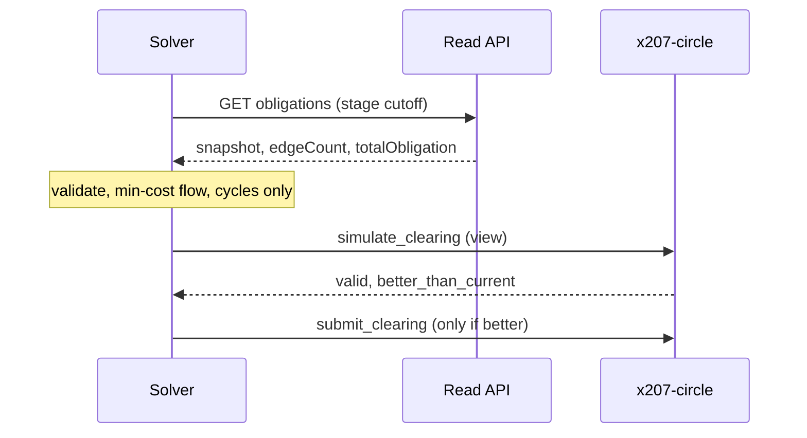

The solver is a small Node program (`x207-solver`). At the end of an epoch the debts in a circle are frozen. The solver reads that obligation graph, computes the largest **cycle-only** clearing, and prints it in the exact shape of `submit_clearing(epoch, edges)`. Everything here is **testnet**; mainnet is not live.

## You do not have to trust a solver

Anyone can run a solver. `submit_clearing` is permissionless. The `x207-circle` contract checks every proposal in `O(n)` and keeps the valid one with the largest `cleared_total`. Two invariants are enough:

1. No edge clears more than is owed. Errors: `ERR_CLEARED_EXCEEDS_OBLIGATION`, `ERR_EDGE_NOT_IN_SNAPSHOT`, `ERR_DUPLICATE_EDGE`, `ERR_ZERO_CLEARED`.
2. Every member clears as much as it receives. Error: `ERR_UNBALANCED_MEMBER`.

A proposal made only of cycles satisfies both and leaves every net position unchanged. A bad solver can only propose a smaller clearing than the best one. It cannot move a net position, create credit, or touch stake. See [Circles](/docs/concepts/circles) for the surrounding model.

## What it computes

Clearing is multilateral netting. The solver:

1. Loads the `cutoff` snapshot of the epoch from the read API and validates it. Amounts are `BigInt`.
2. Computes net positions and routes the net debt as min-cost flow.
3. Keeps whole cycles by value if the result exceeds `MAX_EDGES_PER_TX`.
4. Checks the proposal locally with the contract's rules.
5. Reads `get_epoch`, calls the view `simulate_clearing`, and sends `submit_clearing` only when the simulation is valid and `better_than_current` is true.

The result is deterministic. Ties are broken by a seed from `sha256("<circleId>:<epoch>")`, so two runs on one snapshot print identical bytes.



## Residual and NEAR Intents

The solver does **not** pay the residual and does **not** call NEAR Intents. Its code touches only the read API and the circle contract. Cycles cancel; what is left is the net position of each member.

- A net debtor pays its residual in USDT to the contract (`ft_transfer_call`) inside the payment window. A net creditor then calls `claim`.
- NEAR Intents appears around that step, not in the solver. USDT that arrives as a multi-token transfer stays an Intents balance of the contract until someone withdraws it, and the dashboard has a panel for that. A member may also fund a stake or a residual from another asset through a 1Click quote. See [Dashboard](/docs/dashboard).

## Try it: reproduce epoch 8

Read-only, no key and no NEAR account. `--no-submit` prints the proposal and sends nothing.

```bash
npm ci && npm run build
X207_READ_API_URL=https://x207.boxd.sh node dist/cli.js --epoch 8 --no-submit
```

On 2026-11-04 the log ends with 24 edges, total `41350000`, and a proposal of 18 edges with `cleared_total 21800000`. Source: solver README. That is 21.8 of the 41.35 credit of epoch 8, the figure the contract committed on testnet. Logs go to stderr and the JSON proposal goes to stdout.

## Run it for real

Needs Node 22.22.2 or newer and a reachable read API. To submit you also need a NEAR RPC endpoint, the circle contract id, and an account key. The account needs a few hundredths of a NEAR for gas, no USDT, and no membership. Copy `.env.example` to `.env`.

| Variable | Required | Meaning |
| --- | --- | --- |
| `X207_READ_API_URL` | yes | Read API base URL, without `/x207` |
| `X207_CIRCLE_ID` | no | Circle id, default `agents-main` |
| `MAX_EDGES_PER_TX` | no | Edge limit of one proposal, default `300` |
| `NEAR_RPC_URL`, `X207_CONTRACT_ID`, `SOLVER_ACCOUNT_ID`, `SOLVER_PRIVATE_KEY` | to submit | Set all four or none. The key is `ed25519:<base58>`, kept in `.env`, never printed |
| `SOLVER_GAS_KEY_NONCE_INDEX` | no | For a gas key (NEP-611): the nonce lane, 0 to 1023 |
| `SUBMIT_GAS_TGAS` | no | Gas attached to `submit_clearing`, 1 to 300, default `60` |

```bash
node dist/cli.js --epoch 42
```

Run it inside the proposal window (10 minutes by default).

- Exit code 0: proposal printed or submitted, nothing to clear, window closed, or a stored proposal is at least as good. None of these is retried.
- Exit code 1: bad arguments or config, read API or RPC error, a snapshot that fails validation, an epoch not in the `clearing` phase, or a proposal the simulation rejects. Nothing is submitted.

## Gas

A transaction reserves about 0.001 NEAR per Tgas of prepaid gas, so 60 Tgas reserve 0.061 NEAR (measured on testnet). Before signing, the solver reads the balance and gas price and stops if the balance is short. Measured burn: 28 Tgas for 210 edges on testnet. A gas key pays from its own balance and is not checked.

## Barter and random checks

The package also ships `x207-barter`. `rings` proposes bundles of listings and intents, `seek` prepares offers of the autonomous seeker, and `commit` sends `commit_bundle`. A module in `src/verifier/` reruns a small share of deterministic jobs of metered providers and reports the result to the read API. This is a library with unit tests only. There is no end-to-end run with a real metered endpoint.

Performance numbers are in the benchmark document linked below. Run it with `npm run bench`.

## Source

- [solver/README.md](https://github.com/x207-labs/solver/blob/main/README.md)
- [solver/src/cli.ts](https://github.com/x207-labs/solver/blob/main/src/cli.ts)
- [solver/src/config.ts](https://github.com/x207-labs/solver/blob/main/src/config.ts)
- [solver/src/mincostflow/solve.ts](https://github.com/x207-labs/solver/blob/main/src/mincostflow/solve.ts)
- [solver/src/submit/tx.ts](https://github.com/x207-labs/solver/blob/main/src/submit/tx.ts)
- [solver/docs/gas-and-trust.md](https://github.com/x207-labs/solver/blob/main/docs/gas-and-trust.md)
- [solver/docs/barter-and-spot-checks.md](https://github.com/x207-labs/solver/blob/main/docs/barter-and-spot-checks.md)
- [solver/docs/benchmark.md](https://github.com/x207-labs/solver/blob/main/docs/benchmark.md)
